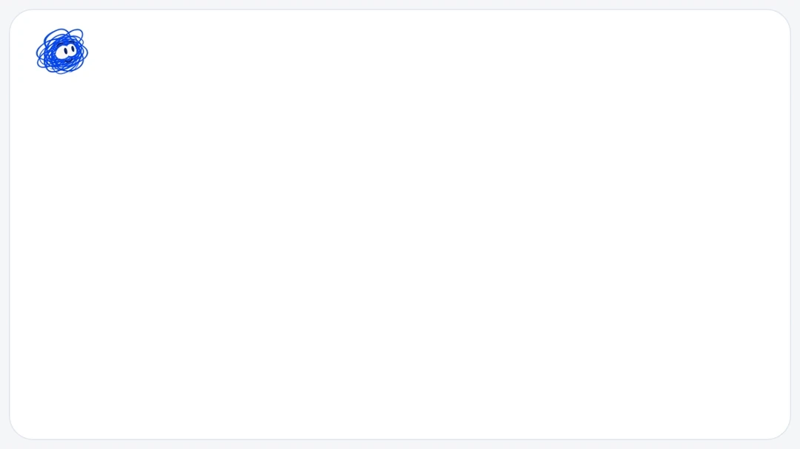
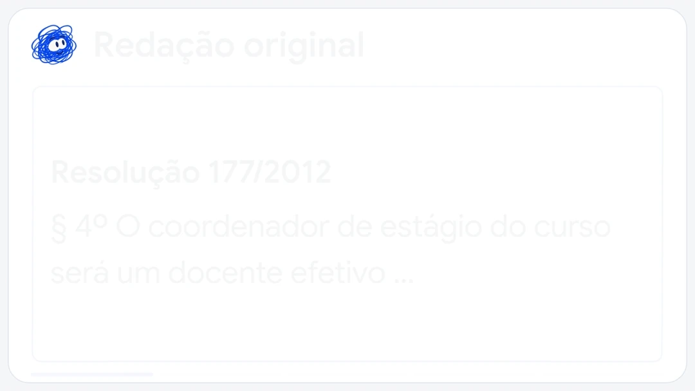
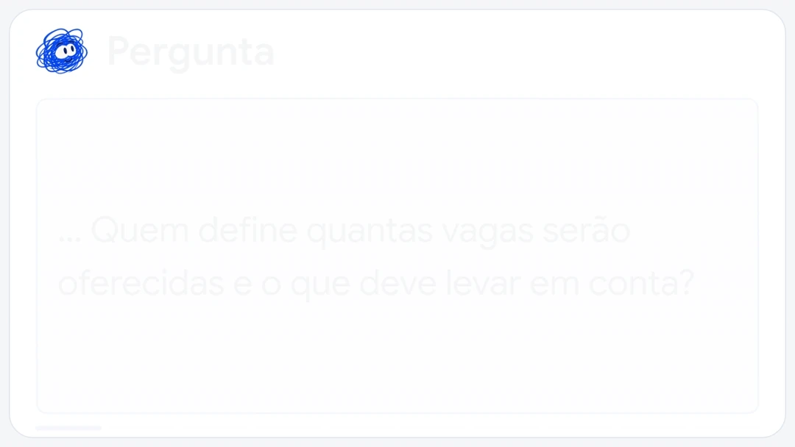
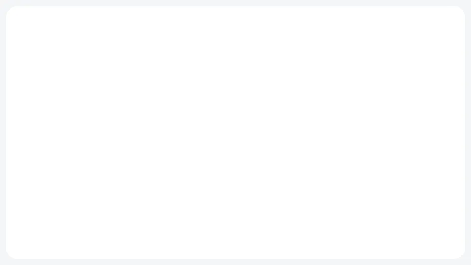
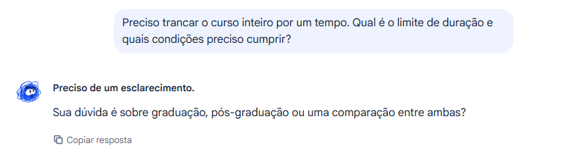
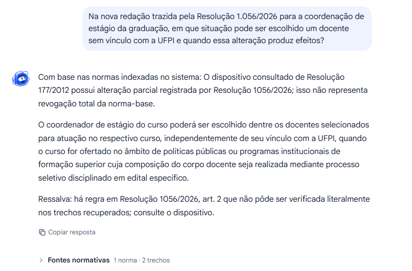
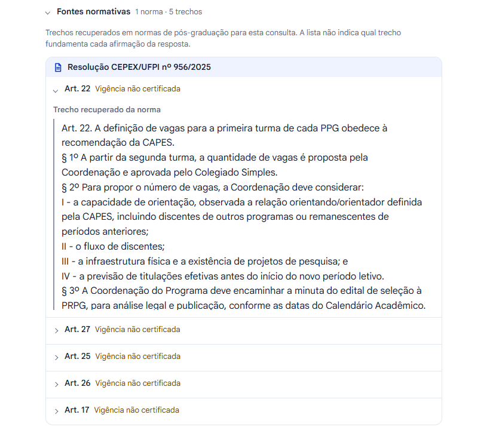
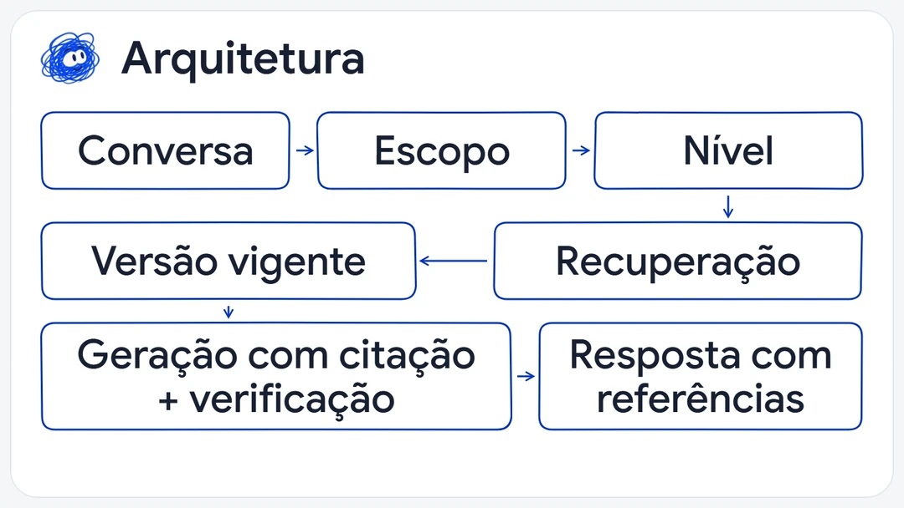
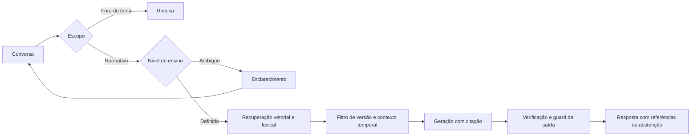

<p align="center">
  
</p>

# Assistente normativo da UFPI

Dúvidas sobre normas acadêmicas, com contexto e referências para consultar a fonte.

[](LICENSE)


> **Protótipo de pesquisa — não é serviço oficial da UFPI.** Confirme as informações nos documentos oficiais antes de tomar decisões acadêmicas.

## O que ele faz

<table>
  <tr>
    <td width="50%" align="center">
      
      <br><strong>Mantém o foco nas normas</strong><br>Recusa perguntas fora do escopo acadêmico do acervo.
    </td>
    <td width="50%" align="center">
      
      <br><strong>Pergunta antes de escolher</strong><br>Esclarece se a dúvida é de graduação ou pós-graduação.
    </td>
  </tr>
  <tr>
    <td width="50%" align="center">
      
      <br><strong>Considera alterações nas normas</strong><br>Filtra versões revogadas e trata a redação aplicável à consulta.
    </td>
    <td width="50%" align="center">
      
      <br><strong>Verifica antes de responder</strong><br>Omite afirmações reprovadas e apresenta referências normativas.
    </td>
  </tr>
</table>

Pergunte ao Bisco quem ele é, como se chama ou como funciona: ele se apresenta e explica o que faz.

O acervo reúne as Resoluções **177/2012**, **1.056/2026**, **956/2025** e **658/2024**: graduação, alteração do art. 68 e pós-graduação, incluindo a norma revogada.

## Demonstração

<p align="center">
  <a href="docs/assets/pitch.mp4"></a>
  <br><a href="docs/assets/pitch.mp4">Assistir ao vídeo completo (74 s, sem áudio)</a> · simulação animada da interface; perguntas e respostas extraídas de conversas reais com o protótipo.
</p>

## Uma consulta, passo a passo

Capturas de conversas reais com o protótipo.

**1. Quando a dúvida não diz o nível de ensino, o assistente pergunta antes de responder.**

<p align="center"></p>

**2. A resposta avisa quando a norma consultada foi alterada e indica o que não pôde ser conferido literalmente.**

<p align="center"></p>

**3. As fontes ficam abertas para consulta, com o trecho recuperado de cada dispositivo.**

<p align="center"></p>

## Arquitetura





[Imagem estática](docs/assets/arquitetura.png) · [Componentes e evolução das condições](docs/PROVENIENCIA.md)

## Resultados em resumo

Resultados **exploratórios**, em conjuntos de desenvolvimento: no C2, ação correta de **0,925 na v3.4 × 0,900 na v2**.
No conjunto sintético, a fração de frases sem suporte ou contraditas caiu de **0,116 para 0,024**; esse conjunto orientou o desenvolvimento.
No conjunto complexo, **a v3.4 não superou a v2**: completude **0,34 × 0,49**, com menos conteúdo entregue.
O verificador confere a forma, sem garantir o sentido. [Resultados, protocolo de anotação e limitações](docs/RESULTADOS.md).

## Contexto do TCC

Trabalho de Conclusão de Curso II do Bacharelado em Ciência da Computação da Universidade Federal do Piauí (UFPI).
**Autor:** Wesley de Sousa Coutinho. **Orientador:** Prof. Armando Soares Sousa.
Investiga como separar decisões de escopo, nível de ensino e versão normativa da geração e verificação da resposta.
Continua o TCC I, que construiu a baseline RAG. [Histórico e créditos](docs/PROVENIENCIA.md).

## Como rodar

Com Docker e o índice v4 preparado, copie o exemplo e preencha `OPENROUTER_API_KEY` e `POSTGRES_PASSWORD` no `.env`:

```powershell
Copy-Item .env.example .env
.\scripts\start-local.cmd
```

No Linux/WSL, use `cp .env.example .env` e `./scripts/start-local.sh`. [Instalação, criação do índice e execução sem Docker](docs/INSTALACAO.md).

## Documentação

| Guia | Conteúdo |
|---|---|
| [Instalação](docs/INSTALACAO.md) | Requisitos, variáveis, índice v4 e execução local |
| [Resultados](docs/RESULTADOS.md) | Comparação exploratória v3.4 × v2 e limitações |
| [Reprodução](docs/REPRODUCAO.md) | Testes offline e avaliações preservadas |
| [Proveniência](docs/PROVENIENCIA.md) | Arquitetura, condições, versões, estrutura e créditos |
| [Linux e operação](docs/DEPLOY_LINUX.md) | Docker, API isolada e provedores alternativos |
| [API](docs/API.md) | Rotas, autenticação e referências estruturadas |
| [Avaliação histórica por QP](docs/tcc2/AVALIACAO_TCCII_JEV_V2.md) | Evidências das condições anteriores |
| [Teste de campo](docs/teste_campo/README.md) | Protocolo (TCLE, roteiro, métricas e análise) e questões do teste com estudantes |

## Licença e créditos

A base de engenharia deriva do *agent-service-toolkit*, de Joshua Carroll, sob a [licença MIT existente](code/LICENSE).
As contribuições do TCC II estão sob a [licença MIT](LICENSE). Os textos das resoluções do acervo são documentos oficiais da UFPI e não são cobertos por essa licença. Bisco não é marca da UFPI. [Créditos e proveniência](docs/PROVENIENCIA.md#créditos-e-licenças).
