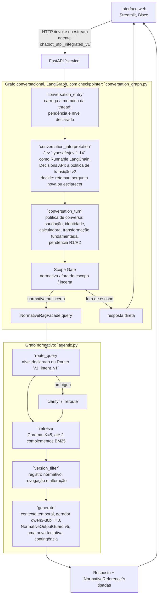

# Arquitetura A″-J v2

O diagrama e as tabelas descrevem o código da tag `tcc2-cond-v2`. Os nomes entre crases são nós, módulos ou funções reais.

## Fluxo de uma mensagem



O `agent_graph.build_integrated_graph` devolve este grafo conversacional sempre que há memória persistente, que é o caso do serviço. O grafo alternativo do mesmo módulo (`action_policy` → `direct_response` / `normative_tool` → `authoritative_emission`) só é montado sem checkpointer e não é usado no protótipo. Sem `CONVERSATION_INTERPRETER`, o nó `conversation_interpretation` não é criado e o fluxo é o de A′.

## Componentes

| Camada | Componente | Arquivos | Muda entre A e v2? |
|---|---|---|---|
| Interpretação | Jev (Decisions API, alpha), exposto como `RunnableLambda` | `conversation_interpretation/jev.py`, `base.py`, `factory.py` | **Novo na v1/v2** |
| Transição | Política determinística v2 (`POLICY_VERSION = "transition-v2"`) | `conversation_interpretation/transition_v2.py` | **Novo na v2** |
| Memória | Pendência e `declared_level` por thread (checkpointer LangGraph: SQLite nos experimentos; PostgreSQL na demonstração, sem mudança de código) | `conversation_policy.py`, `conversation_contracts.py`, `conversation_graph.py` | **Alterado (R1/R2)** |
| Escopo | Scope Gate (LLM): não escolhe o nível de ensino | `scope_gate.py` | Idêntico |
| Roteamento | Nível declarado ou Router V1 | `agentic.py`, `router.py` | Idêntico |
| Recuperação | `dense_vector`, `metadata_exact`, `vector_filtered`; BM25 complementar | `retrieval_policy.py`, `retrieval_service.py`, `lexical_retrieval.py` | Idêntico |
| Versão | `VersionFilter`, `TemporalGroundingContext` | `versioning.py`, `grounding.py` | Idêntico |
| Geração e validação | `RagService.generate`, `NormativeOutputGuard` v5, uma regeneração | `service.py`, `normative_output.py`, `evidence_support.py` | Idêntico |
| Referências | `NormativeReference` tipadas, do transporte à interface | `output_contracts.py` | Idêntico |

### Ativação da v2

O código, por padrão, executa a política v1. A v2 exige as duas variáveis abaixo, que o `compose.demo.yaml` fixa:

```
CONVERSATION_INTERPRETER=jev
CONVERSATION_INTERPRETER_CONFIG={"transition_policy":"v2"}
```

O launcher `deploy/backend/prototype_launcher.py` resolve a configuração com o carregador congelado (`interpreter_config`) e recusa o início com qualquer outra combinação.

## Evolução A → A′ → A″-J v1 → A″-J v2

| Versão | Mudança | Ganho observado (exploratório, DEV) | Limitação |
|---|---|---|---|
| A | Baseline congelada | — | A resposta natural ao pedido de esclarecimento era tratada como pergunta nova |
| A′ | R1: gramática de esclarecimentos naturais; R2: nível declarado persistido | Esclarecimento reconhecido 3/21 → 21/21 nos casos de dois turnos | Formulações fora da gramática: 0/11 (Etapa 5); R2 dá origem ao G4-014 |
| A″-J v1 | Intérprete Jev antes da política | Fora da gramática 0,00 → 0,83 (Etapa 6) | Classes inseguras: 12/417 falsos consumos; retomada com nível de terceiro |
| A″-J v2 | Política de transição v2 | Falso consumo 12 → 0/417; nível de terceiro 16 → 0; contra A, decisão correta +0,167 [+0,033; +0,283] com rótulos do pesquisador | E6 não atendido (0,67 contra 0,89 de A′); consistência 0,90; G4-014 aberto; resposta entregue não melhora (H-2) |

Também foram implementadas, avaliadas e **não promovidas**:

- variantes de "RAG adaptativo": suficiência pré-geração, recuperação complementar e validação semântica por afirmação;
- K = 10 e reordenação;
- Router V2 (sondagem do acervo);
- intérprete LLM estruturado (A2L).

## Infraestrutura de demonstração (fora do código congelado)

| Arquivo | Função |
|---|---|
| `compose.demo.yaml` | Três serviços: `postgres` (checkpoints, só rede interna), `backend` e `interface` |
| `deploy/compose.external-postgres.yaml` | Checkpoints num PostgreSQL externo (serviço gerenciado) em vez do container |
| `deploy/backend/Dockerfile` | Imagem do backend; o build falha se um arquivo do backend diferir do manifesto congelado (`frozen_sources.py`) |
| `deploy/backend/prototype_launcher.py` | Exige a configuração avaliada (Jev + v2, modelos, K, endpoint), salvo `PROTOTYPE_ALLOW_UNEVALUATED_CONFIG=true`; publica `GET /prototype/identity` |
| `deploy/backend/healthcheck.py` | Saudável só com o agente pronto (índice carregado) e a identidade jev/v2, ou com uma configuração não avaliada explicitamente permitida (`PROTOTYPE_ALLOW_UNEVALUATED_CONFIG=true`) |
| `deploy/interface/Dockerfile` | Imagem da interface; sem credenciais e sem pipeline RAG |
| `scripts/start-local.cmd`, `stop-local.cmd` | Início e parada em um comando (Windows) |
| `deploy/compose.api.yaml` | Publica a API do backend em `127.0.0.1:8080` |
| `deploy/compose.openai-compatible.yaml` | Provedor compatível com a OpenAI, local ou remoto, com índice próprio e sem Jev; configuração não avaliada |
| `deploy/compose.smoke.yaml` | Teste offline: backend sem saída de rede |
