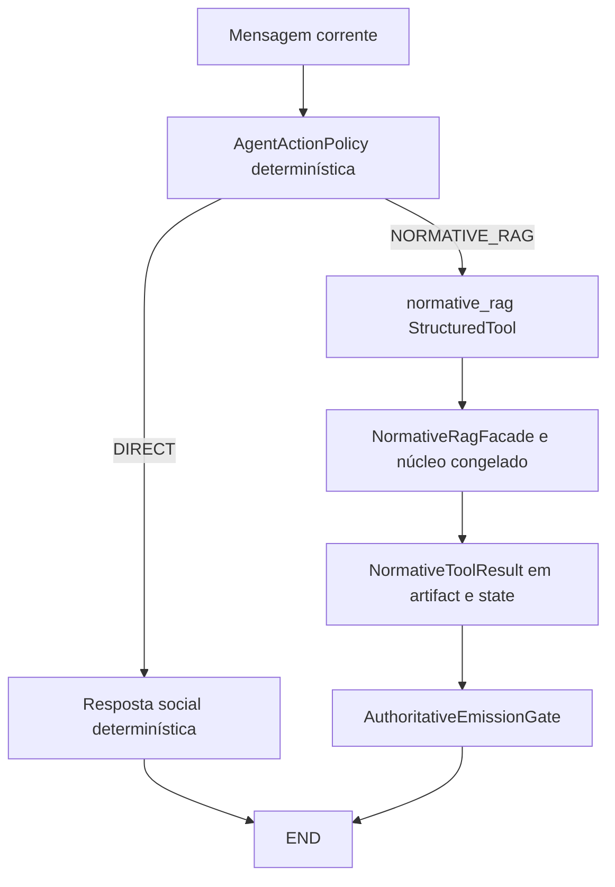

# Agent Normative Integration V1 — emissão autoritativa intra-turno

Data: 31/10/2026. Verificação local de engenharia com providers controlados, sem avaliação jurídica, LLM real ou reexecução dos 44 casos.

O novo grafo interno encaminhou **18/18 turnos NORMATIVE_RAG do conjunto técnico pela facade**, preservou **24/24 respostas ANSWER exatamente** e conservou **26/26 resultados tipados** nas execuções avaliadas. As três estratégias internas foram alcançadas pela mesma capacidade `normative_rag`. DIRECT aceita somente uma lista fechada de turnos sociais completos. O grafo termina após a emissão autoritativa, sem LLM superior.

Esses resultados verificam composição e contratos. Não medem inteligência do agente, qualidade de retrieval ou correção jurídica. O agente permanece fora do registry público; transporte tipado, memória e uso externo continuam pendentes.

## 1. Objetivo

Integrar a capacidade normativa ao mecanismo real de tools e a um novo StateGraph, impondo uma fronteira de ação e uma entrega final controladas pela aplicação. A intervenção acrescenta quatro módulos e um arquivo de testes; nenhum arquivo anterior foi modificado.

## 2. Estado inicial

Branch `feat/retrieval-strategies-v1`, HEAD `19a0aed5d17dfedec470881796d2e10f3edbb3e6`, árvore limpa. Status, branch, HEAD, log de 15 commits, diff, staged diff e stat estão em [initial_audit.json](initial_audit.json). A branch `feat/agent-normative-integration-v1` foi criada exatamente desse HEAD.

## 3. Núcleo preservado

A autoridade continua Router V1 → Temporal Intent → retrieval interno → Version Filter → grounding → Structured Output V2 → NormativeToolResult V1. Router V2 também foi preservado. Facade, contratos, estratégias, prompts, guard, retry e fallback não mudaram. As limitações V2, incluindo cronologia documental ampla final 7/44 no experimento anterior, permanecem; não foram medidas novamente.

## 4. Arquitetura antes

Os chatbots legados usam `bind_tools`, decisão de tool pelo modelo e ciclo model → ToolNode → model. O default `chatbot_ufpi_v2` mantém Supabase. A facade atual já devolvia resultado tipado, mas não havia uma tool normativa nem grafo superior com emissão autoritativa.

## 5. Arquitetura depois

O builder [agent_graph.py](../../../code/src/rag_baseline/agent_graph.py) recebe uma facade confiável por injeção e compila `chatbot_ufpi_integrated_v1`. Ele não inicializa providers no import. Ficou em `rag_baseline`, evitando a importação de `agents.__init__`, que carrega o registry e grafos legados com efeitos de inicialização.

## 6. Action boundary

[AgentActionPolicy](../../../code/src/rag_baseline/agent_policy.py) decide somente DIRECT ou NORMATIVE_RAG. Não escolhe graduação/pós/ambas, não interpreta temporalidade e não substitui Domain Router. Tudo que não corresponde ao turno social completo segue para a capacidade normativa, inclusive consulta não normativa, follow-up sem memória ou pedido de cálculo.

## 7. DIRECT V1

Lista fechada: oi, olá, bom dia, boa tarde, boa noite, obrigado, obrigada, entendi, até mais e tchau. Normaliza composição Unicode, caixa, espaços externos e pontuação terminal `. ! ?`. Não remove palavras nem usa substring. As respostas são determinísticas. Reason codes: `safe_greeting`, `safe_thanks`, `safe_acknowledgement`, `safe_farewell`; demais: `requires_normative_tool`.

“Obrigado, mas posso cancelar?” e “Bom dia, qual é o prazo?” não entram em DIRECT. Formas sociais fora da lista podem acionar RAG; isso é custo operacional aceito desta V1, sem alegação de recall linguístico geral.

## 8. normative_rag tool

[build_normative_tool](../../../code/src/rag_baseline/agent_tool.py) cria `StructuredTool`, uma BaseTool real, assíncrona, descrita como consulta normativa acadêmica da UFPI pelo pipeline controlado. A única operação normativa é `NormativeRagFacade.query`. Não duplica parser, selector, retrieval, router, filtro, grounding ou geração.

## 9. Input estreito

`NormativeToolInput` exige question string estrita, tamanho 1–4000; correlation_id UUID é opcional. `clarification` é opcional e aceita somente null: esta etapa não possui uma pendência válida mantida pelo pai, portanto texto de continuação é rejeitado antes da facade. Isso conserva a condição de autorização do pedido, sem inventar memória de esclarecimento.

Extra fields são proibidos, incluindo scope, sector, manual_scope, version_filter, retrieval_strategy, top_k, model, temperature, raw, raw_search, backend e filters. Pergunta vazia/excessiva ou modalidade não suportada termina com erro seguro e zero chamadas à facade. Esses inputs inválidos não compõem o denominador de bypass dos turnos técnicos válidos.

## 10. Tool output e artifact

[framework_audit.json](framework_audit.json) registra leitura da versão instalada e probe offline: LangChain core 0.3.68 e LangGraph 0.5.2 suportam `response_format="content_and_artifact"`. A coroutine devolve `(resumo operacional, NormativeToolResult)`; `ainvoke` com ToolCall produz ToolMessage com artifact tipado. Uma chamada apenas com dict de args devolve conteúdo e perde esse acesso ao artifact; o nó usa explicitamente ToolCall.

O conteúdo é somente `normative_rag: STATUS`. A emissão não o reinterpreta. O resultado é revalidado estruturalmente, incluindo campos mutáveis aninhados, e a correlação precisa corresponder à operação. Nenhum schema público anterior foi alterado.

## 11. State

`IntegratedAgentState` compõe MessagesState, com action, decisão, pergunta corrente, normative_result, normative_correlation_id e AgentTurnAudit. Não reutiliza AgenticState. NormativeToolResult permanece objeto tipado, incluindo core_status, domain, retrieval_strategy, versões, referências e provenance; audit privado permanece interno.

Cada entrada limpa resultado, decisão, correlação e audit anteriores. Blocos textuais reais do framework são concatenados conservando todos os blocos e separadores; modalidades não textuais não são interpretadas. Histórico eventualmente fornecido não resolve elipses: usa a última HumanMessage e não implementa follow-up grounded.

## 12. Topologia e escolha do nó

START → action_policy → direct_response → END, ou action_policy → normative_tool → authoritative_emission → END. Não há loop, bind_tools superior, generic_model, nested interrupt ou checkpointer conectado.

Foram auditados ToolNode e nó específico. ToolNode conserva artifact, mas foi preterido: a capacidade é escolhida deterministicamente e o nó específico torna explícitos uma chamada, tipagem, correlação, receipt e emissão terminal. Ele ainda invoca uma BaseTool verdadeira. A futura calculator poderá ter outro ramo; não foi criada nesta etapa.

## 13. AuthoritativeEmissionGate

[agent_emission.py](../../../code/src/rag_baseline/agent_emission.py) revalida o contrato e cria AIMessage exclusivamente de answer, clarification_question ou safe_message conforme o status. Não chama LLM, normaliza whitespace, acrescenta prefixo ou resume. Os testes comparam strings e bytes, incluindo espaços e CRLF.

O teste de não reescrita instala um modelo superior fake que tentaria devolver “Vou reformular a resposta...” e confirma zero chamadas. O gate não transforma aceitação do V2 em certificação jurídica.

## 14. References

Referências oficiais permanecem em `state.normative_result.references`, inclusive os campos norm_id, article, validated_subdivision, display_text e temporal_role. Não são reconstruídas de AIMessage/ToolMessage. O campo legado Reference.content não é promovido a fonte oficial. O transporte público dessas referências continua pendente.

## 15. Provenance, domínio e estratégia

temporal_provenance tipada, allowed_temporal_facts, core_status, domain, retrieval_strategy, correlation_id, contract_version e core_version permanecem no resultado. A comparação usa o objeto completo emitido pela facade versus o retido no state. CLARIFICATION/ERROR conservam seus campos nulos conforme o contrato, sem provenance inventada.

## 16. Clarification

O Router V1 real com provider controlado produziu CLARIFICATION. O grafo emitiu a pergunta idêntica, conservou correlação e terminou: um router, zero embedding, zero geração e retrieval não executado conforme audit do núcleo. Não há nova busca, reformulação, pendência persistida ou continuação automática.

## 17. Erros e isolamento

ERROR emite safe_message exata. O probe de erro usa conflito intencional entre norma e escopo controlado no router. Exceções inesperadas ou retorno inválido no adapter viram ERROR com texto fixo e apenas nome de classe no audit interno. Não se publica exception, traceback, prompt, provider body ou caminho. Cancelamento propaga; não vira resposta.

Um receipt local por invocação mede chamadas reais. Se um callback de conclusão falha depois da facade devolver, o nó recupera e revalida o resultado do receipt, conserva a emissão exata e não chama a facade novamente. Erros anteriores à execução contam zero. Uma execução posterior reinicia o estado transitório.

## 18. Bypass protection

Nos 18 casos técnicos NORMATIVE_RAG, a ação não terminou em DIRECT e houve exatamente uma chamada à facade. Foram rejeitados campos capazes de escolher scope/estratégia/desativar filtro, resultado textual no lugar de objeto, correlação estrangeira e resultado construído/mutado inválido. A auditoria registra action, reason, nós, chamadas, status, estratégia, correlação e fonte final, sem conteúdo integral do corpus.

Somente normative_rag é capacidade normativa do novo grafo. Supabase searches, RagService.retrieve, MetadataExactEngine e FilteredVectorEngine não são tools registradas nele. Não há afirmação de que essa lista finita prova proteção semântica universal ou modifica os agentes legados.

## 19. Retrieval através do agente

Consulta conceitual alcançou dense_vector; norma/artigo alcançou metadata_exact sem embedding; norma/tema alcançou vector_filtered. Usaram Router V1, selector, Version Filter e V2 reais com provider controlado e Chroma local. Nos unit tests, Chroma temporário usa vetores controlados de duas dimensões; nos probes, a coleção existente utiliza replay de vetores 1536 já armazenados.

Os vetores replay não demonstram relevância para as novas perguntas. A integração preserva a seleção automática interna e não expõe estratégia ao caller. Versões e contexto temporal são os do núcleo, sem flags de bypass.

## 20. Concorrência

Duas consultas simultâneas no mesmo grafo/facade — metadata graduação e filtered pós — conservaram objetos, IDs de correlação, referências, domínios e estratégias distintos. O receipt, tool e audit são locais ao turno; não há monkeypatch produtivo ou troca de dependência global. O teste e o par de probes verificam essa composição; não constituem benchmark de carga.

## 21. Probes

[local_probes.py](local_probes.py) e [local_probes.json](local_probes.json) registram nove grupos, dez execuções: greeting, thanks, mixed, dense, exact, filtered, clarification, controlled error e par concorrente. Foram seis ANSWER, uma CLARIFICATION, um ERROR e dois DIRECT. O harness bloqueia HTTP externo. Nenhuma API real ou RPC Supabase foi chamada.

O harness foi repetido após a formatação final. Todos os resultados estão registrados, sem seleção de melhores saídas. Não usa juiz LLM nem avalia qualidade da resposta fake.

## 22. Métricas técnicas

O [dataset operacional](../../datasets/agent_action_policy_v1.json) tem 24 casos explícitos: seis sociais e 18 NORMATIVE_RAG, incluindo 12 com pergunta normativa, três follow-ups, dois calculator-like e uma forma social fora da lista. [technical_regression.json](technical_regression.json) preserva resultados e denominadores.

| Métrica | Numerador/denominador | Escopo |
|---|---:|---|
| Action Policy Accuracy | 24/24 | dataset com facade double tipada |
| Normative Bypass Count | 0/18 | NORMATIVE_RAG do dataset sem chamada à facade |
| Authoritative Answer Preservation | 24/24 | 18 ANSWER do dataset + seis dos probes |
| Structured Result Preservation | 26/26 | 24 ANSWER + CLARIFICATION + ERROR |
| Clarification Preservation | 1/1 | probe com Router V1 real/controlado |
| Direct False-Allow | 0/12 | perguntas normativas explícitas do dataset |
| Uma facade call por turno normativo | 18/18 | dataset; também 8/8 nos probes |

Structured preservation compara o modelo público completo, incluindo referências/provenance/domain/strategy/correlação e nulidade dos campos não aplicáveis, além da verificação do tipo. Audit privado tem teste próprio de conservação; não foi serializado nos resultados públicos dos probes. Essas taxas não são métricas de inteligência, retrieval ou correção jurídica.

## 23. Registry e default

Não há registro público do novo grafo. O registry e default `chatbot_ufpi_v2` permanecem idênticos. Esse isolamento evita prometer suporte pelo serviço legado que descarta artifact e referências tipadas. O builder é invocável internamente com dependências confiáveis.

## 24. Service, client e UI pendentes

Nenhuma alteração em endpoints, ChatMessage, SSE, AgentClient, Streamlit, history ou feedback. A entrega não oferece um novo endpoint nem frontend. A próxima implementação recomendada é transporte tipado e gate de emissão no serviço, antes de expor o agente; isso exige revisão própria e não foi iniciado.

## 25. Memory pendente

Não há persistência de NormativeToolResult, últimas referências, provenance, pending clarification ou ownership. O builder não conecta checkpointer/store. A reutilização sintética de um state nos testes verifica limpeza, sem criar memória multi-turn. “E na pós?” e “explique melhor” acionam uma consulta nova e não recebem resolução contextual nesta V1.

## 26. Calculator futura

O enum tem somente duas ações. “10 dias a partir de amanhã” e “2+2” seguem RAG conservadoramente. Não há cálculo ou nova calculator. A calculator legada e seus bindings permanecem intocados. A topologia permite acrescentar um ramo futuro sem modificar a autoridade normativa.

## 27. Decisões públicas

[decision_log.jsonl](decision_log.jsonl) registra decisões, alternativas, evidência, testes e actual_effect. [execution_log.jsonl](execution_log.jsonl) registra eventos observáveis da auditoria, TDD, revisão técnica, probes, preservação, testes e commits.

## 28. Resultados negativos e TDD

O primeiro arquivo RED foi commitado com 55 erros de setup causados por ausência do módulo. A fixture foi corrigida para adiar a falha ao acesso: **55 falhas esperadas** antes de escrever produção; primeiro GREEN 55. Um teste que construía deliberadamente um objeto Pydantic inválido produziu warning de serializer; a fixture foi ajustada para isolar a invalidação relevante sem esse warning.

Dois testes adicionais observaram RED para contagem incorreta de chamadas em entradas recusadas; depois, 57 verdes. A revisão reproduziu dois problemas reais: perda de text blocks e perda de resultado/contagem em callback de conclusão. Quatro regressões observaram RED, depois **61 verdes**. A revisão repetida não encontrou Critical/Important pendentes. [review_findings.json](review_findings.json) registra somente achados públicos de código e correções.

Permanecem resultados operacionais limitados: DIRECT não cobre toda conversa social, follow-ups não são resolvidos, cálculo não é executado, modalidades não textuais são recusadas e o agente não tem transporte público compatível. O V2 conserva suas próprias exposições conhecidas.

## 29. Limitações

Dataset finito e explícito, provider/geração controlados, sem usuários ou gold jurídico. A fronteira conservadora pode chamar RAG para conteúdo não normativo. Resultados ANSWER completos não comprovam verdade jurídica. Não se mediu carga, disponibilidade remota, deploy, cobrança, autenticação ou persistência. Nenhum resultado autoriza afirmar prontidão para uso amplo.

## 30. Preservação

[preservation_before.json](preservation_before.json) e [preservation.json](preservation.json) conferem **617/617 arquivos anteriores idênticos**, incluindo produção, todos os resultados e testes anteriores. Router V1/V2, Temporal Intent, dense, estratégias, Version Filter, grounding, Structured Output V1/V2, facade, contratos, registry, corpora, service/client/UI/memory e calculator permanecem byte a byte iguais.

Os **507 registros** conservam IDs, documentos, metadados e embeddings float32. SHA-256 lógico: `ab253a24b756d9f3d3e05aeb49220798b08d947704112327fd894a577bb2b38a`. Sem metadata update, reindexação ou re-embedding. A regra -text é local à nova pasta de resultados, preservando seus bytes no Git.

## 31. Verificações

[test_results.json](test_results.json) e os stdout pytest registram comandos, timestamps e resultados finais das oito seleções. Seleções se sobrepõem e não devem ser somadas.

| Seleção | Resultado |
|---|---:|
| Novos focused agent | 61 passed |
| Retrieval Strategies | 76 passed |
| Facade/contracts | 79 passed |
| Structured Output V1/V2 | 122 passed |
| Cinco arquivos temporais | 93 passed |
| rag_baseline | 624 passed, 10 skipped |
| Legacy core/service/client/app/integration | 63 passed, 2 skipped |
| Suíte completa | 687 passed, 12 skipped |
| Ruff check / format-check, seis Python | aprovados |
| git diff --check | exit 0 |

Os quatro warnings completos são legados: dois Pydantic de dependência, AsyncMock no client e timeout de Starlette TestClient. AppTest usa harness isolado; não houve frontend ao vivo. Os testes Docker opt-in permaneceram skipped. A última alteração no arquivo de testes foi somente ordenação de imports pelo Ruff; a suíte completa verificou esse arquivo final.

A primeira seleção Structured executou somente 61 testes por omitir content_locators; a seleção final correta executou 122. A primeira seleção temporal usou test_agentic.py inexistente e não executou testes; foi corrigida para test_agentic_pipeline.py e 93 passaram. [verification_selection_correction.json](verification_selection_correction.json) e os stdout iniciais preservam esses fatos. Não houve falha de teste omitida ou mudança no núcleo para obter verde.

## 32. Commits e entrega local

1. `205948d` — `test: define authoritative normative agent boundary`.
2. Implementação — `feat: integrate normative rag capability into agent graph`.
3. Evidências — `test: verify normative agent emission and bypass protection`.

O SHA do commit de evidências não pode constar no próprio conteúdo que determina seu hash. Manifest, verification e ARTIFACTS registram o conteúdo verificado; ARTIFACTS exclui a si próprio.

Sem push, merge, rebase, pull, reset ou limpeza destrutiva. Sem mudança de default, serviço/client/UI, memória multi-turn, calculator ou deploy. Não foram adicionados artefatos de processo de IA. A implementação termina no grafo interno e na emissão autoritativa intra-turno; nenhuma etapa posterior foi iniciada.
