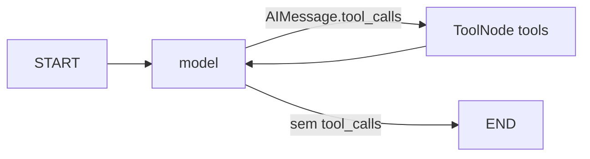
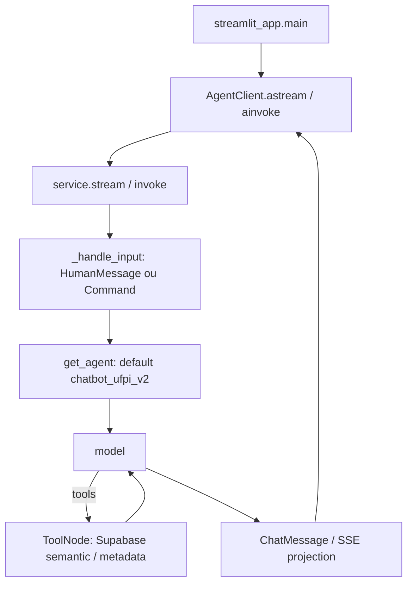
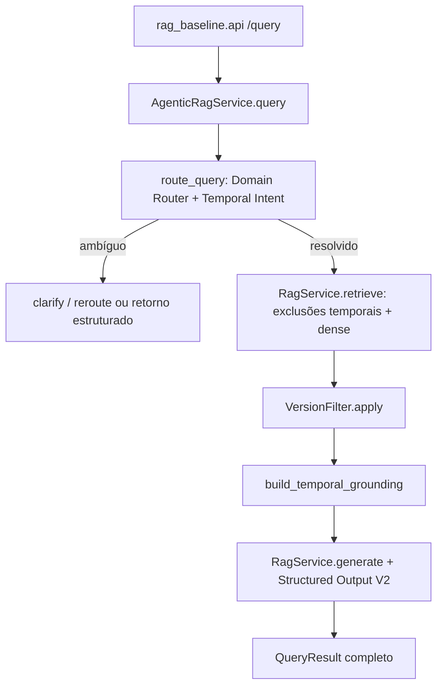
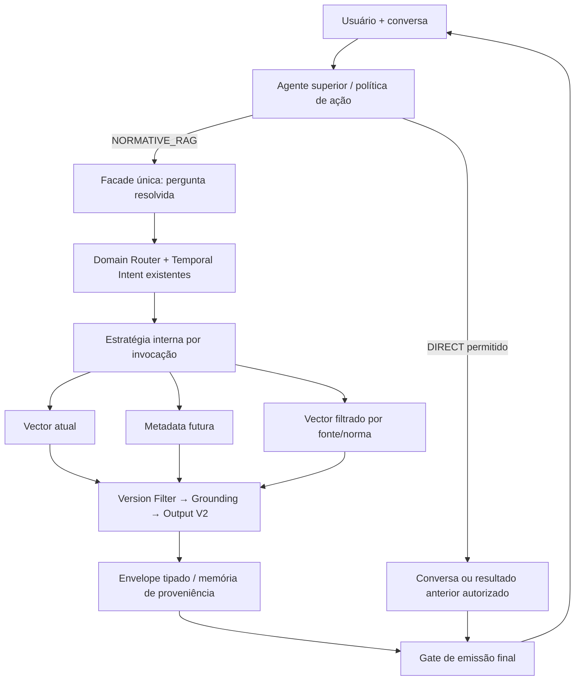

# Auditoria da integração agêntica/conversacional com o núcleo V2

Data: 31/10/2026. Auditoria arquitetural local, sem implementação de integração, chamadas reais a modelos, execução de buscas remotas ou nova avaliação dos 44 casos.

**Recomendação: opção B, uma ferramenta normativa única com vector e metadata como estratégias internas.** A infraestrutura tem conversa, tool calling, checkpoints e transporte reutilizáveis, mas ainda não impõe a barreira exigida. O default continua sendo o chatbot legado com Supabase; o wrapper do núcleo já registrado perde o resultado estruturado na projeção para mensagens. Apenas acrescentar uma tool e deixar o agente reescrever sua saída não preservaria as garantias do V2.

Os principais bloqueadores são exposição de evidência crua, perda de referências/proveniência, ausência de controle da emissão final, identidade de thread/usuário/agente, incompatibilidade dos metadados e empacotamento incompleto. Nenhum foi corrigido nesta auditoria. O núcleo V2 e suas limitações permanecem congelados.

## 1. Objetivo

Identificar o menor conjunto de adaptadores para preservar conversa, resposta direta, tools, vector e metadata sem permitir que nova resposta normativa contorne Domain Router, Temporal Intent, Version Filter, grounding e Structured Output V2. O resultado é uma recomendação e proposta de trabalho posterior, não uma integração pronta.

## 2. Estado inicial

Branch verificada: `fix/structured-normative-output-v2`. HEAD: `34c42c7d1d46edd09a720b2d672be6493f665eb1`. Árvore limpa. Foram registrados status, branch, HEAD, 15 commits, diff, staged diff e diff stat em [initial_audit.json](initial_audit.json).

Branch local de auditoria criada exatamente desse HEAD: `audit/agentic-conversational-integration-v1`. Todos os arquivos novos pertencem a esta pasta de resultados. O commit local de auditoria tem mensagem `audit: map legacy agentic infrastructure for v2 integration`.

## 3. Núcleo científico congelado

A versão selecionada é Structured Normative Output V2: referências oficiais 0/44 respostas e 0/213 entradas com violação; SLAR 78/80; final ULER 0/44; fallback 2/44; conclusão 42/44; detecção conhecida 6/6; cronologia documental ampla final 7/44. Esses números são do experimento anterior, não foram medidos novamente.

O V2 não certifica vigência global nem correção jurídica geral. Permanecem suas exposições de datas documentais, falsos positivos e ambiguidade de B. Não se propõe V3, tuning ou reaplicação dos mesmos 44 casos. [current_core_architecture.json](current_core_architecture.json) mapeia o caminho selecionado.

## 4. Escopo e método

Foram inspecionados os caminhos reais de agents, memory, service, client, schemas, Streamlit, entrypoints, `langgraph.json`, configuração, Docker/Compose, dependências e testes, além do núcleo normativo. O inventário contém 19 fontes Python em agents, 12 exports de grafos, quatro IDs registrados e 13 entradas de tools, incluindo duas handoffs geradas.

[inventory.json](inventory.json) organiza os componentes; [dependency_occurrences.json](dependency_occurrences.json) registra 760 ocorrências de identificadores em fontes/configuração/scripts, sem copiar valores. As conclusões distinguem leitura de código, metadados instalados, testes existentes e probes sintéticos. Não foram iniciados servidores, containers, modelos ou ferramentas de busca.

## 5. Arquitetura legada real

`run_service.py` carrega `service:app`; `agents/agents.py` registra `chatbot_ufpi_agentic`, `chatbot_ufpi`, `chatbot_ufpi_v2` e `chatbot_generic`. O default é **`chatbot_ufpi_v2`**, que usa as tools Supabase legadas. O wrapper `chatbot_ufpi_agentic` já aponta para `rag_baseline.agentic.build_graph(interactive=True)`, mas não é o default.

Há oito grafos importados sem registro ativo, incluindo research, supervisor, interrupt e knowledge base. Importá-los ainda pode construir objetos: o supervisor cria modelo no import. `code/langgraph.json` seleciona somente `research_assistant`, uma terceira escolha de entrada distinta do default do serviço e do wrapper normativo. Evidências: `agents/agents.py:6–56`, `chatbot_ufpi_agentic.py:3–7` e `langgraph.json:4–5`.

## 6. LangGraph real

Os chatbots genérico/UFPI/V2 usam o ciclo abaixo; o tool calling do LLM decide a aresta. Não há um Action Router determinístico independente nesse caminho.

`messages` usa o reducer `add_messages`; os chatbots têm `remaining_steps: RemainingSteps`. O serviço injeta checkpointer/store nos grafos registrados durante o lifespan. O orçamento do framework e a verificação de passos não equivalem a um limite explícito de chamadas normativas por turno. Exemplos não registrados possuem outros fluxos: safety no research/RAG, Command no command agent, retrieve obrigatório no knowledge base, tarefas customizadas e interrupt de data de nascimento. Topologias completas, nós, arestas, reducers, terminações e erros estão em [legacy_agents_graphs.json](legacy_agents_graphs.json).

## 7. Agents

| Agente | Situação | Tools/comportamento relevante |
|---|---|---|
| chatbot_ufpi_v2 | default registrado | Supabase semantic + metadata; pode responder sem tool |
| chatbot_ufpi | alternativa registrada | Supabase RAG; pode responder sem tool |
| chatbot_generic | alternativa registrada | Calculator + data/hora; conversa direta |
| chatbot_ufpi_agentic | alternativa registrada | grafo normativo completo, sem ciclo de tools legado |
| chatbot | importado, não registrado | conversa funcional simples |
| research_assistant | importado; alvo de langgraph.json | safety, web/weather/calculator |
| rag_assistant | importado, não registrado | safety e Chroma de handbook antigo |
| kb_agent | importado, não registrado | Bedrock Knowledge Base; contexto próprio |
| interrupt_agent | importado, não registrado | exemplo de birthdate/store/interrupt |
| command_agent | importado, não registrado | exemplo de roteamento por Command |
| bg_task_agent | importado, não registrado | eventos customizados de tarefas |
| langgraph_supervisor_agent | importado, não registrado | workers math/research e handoffs |

O inventário registra modelo/provider, prompt, estado, tools, memória, stream, condição de término e retry por agente. Prompts normativos antigos contêm fatos fixos e não impõem busca obrigatória: não devem ser a autoridade normativa da integração.

## 8. State

O legado usa principalmente `MessagesState` e variantes com `remaining_steps`; exemplos acrescentam safety, birthdate ou documentos de KB. O núcleo usa `AgenticState`, com question, clarification, decision, chunks, audit, result, use_version_filter, historical, error, routing_audit, query_embedding, temporal_intent, manual_scope e temporal_grounding.

São tipos diferentes com reducer de mensagens comum. Não se recomenda unificá-los: compor um estado externo conversacional com um resultado/handle normativo versionado é suficiente. `route_query` limpa chunks/result/grounding a cada pergunta e lê o último humano; a presença de histórico não resolve automaticamente elipses. [state_contracts.json](state_contracts.json) especifica campo, tipo, produtor, consumidor, persistência, sensibilidade e mapeamento futuro.

## 9. Memory

O lifespan cria um saver/store compartilhado. SQLite é o default: checkpoints em arquivo, mas store de longo prazo em memória. Postgres oferece saver e store persistentes. Mongo oferece saver; seu store cai no fallback em memória. Não foi encontrada configuração de TTL da aplicação; o factory Mongo não usa a opção de TTL disponível na biblioteca.

O identificador efetivo é `thread_id`; `user_id` é fornecido pelo cliente ou gerado e não representa autenticação de proprietário. Os grafos compartilham saver sem partição explícita de agente. O único consumidor encontrado do store cross-thread é o exemplo de birthdate, não registrado. Não há contrato backend separado de `session_id`.

Probes isolados, sem grafo produtivo, confirmaram: três mensagens sobrevivem ao fechamento/reabertura de SQLite; outra thread fica vazia; o mesmo thread_id com outro user_id lê o mesmo estado; ToolMessage.artifact sobrevive ao checkpoint. Um roundtrip de QueryResult perdeu response_kind/generation_attempts/output_audit excluídos, restaurando defaults, embora o dump público fosse igual. Isso exige política explícita de persistência interna. Evidências em [offline_contract_checks.json](offline_contract_checks.json) e [memory_configuration.json](memory_configuration.json).

## 10. Service

| App | Endpoint | Contrato |
|---|---|---|
| legado | GET /info | agents, modelos e defaults |
| legado | POST /invoke e /{agent_id}/invoke | UserInput → ChatMessage final/interrupt textual |
| legado | POST /stream e /{agent_id}/stream | StreamInput → SSE message/token/error + DONE |
| legado | POST /history | thread_id → mensagens do DEFAULT_AGENT |
| legado | POST /feedback | run_id/key/score → LangSmith |
| legado | GET /health | status básico; não atesta índice/modelo/DB |
| normativo separado | POST /query | QueryRequest → QueryResult completo |
| normativo separado | GET /health | contagem, coleção, modelos, configuração |

UserInput contém message, model, thread_id, user_id e agent_config. StreamInput acrescenta stream_tokens. A API normativa não tem thread/session nem stream; aceita question, sector, clarification e version_filter. **O parâmetro existente version_filter=false é incompatível com a futura barreira obrigatória**, e o adapter não deve expô-lo ao LLM/usuário. Escopo manual também evita Domain Router; a futura tool deverá usar roteamento automático.

O serviço legado possui autenticação opcional por segredo Bearer compartilhado, sem vínculo proprietário/thread. O tratamento de erro é predominantemente genérico; a API normativa distingue erros de índice/provider/validação. O detalhe de cada endpoint está em [service_client_contracts.json](service_client_contracts.json).

## 11. Client

AgentClient oferece invoke/ainvoke e stream/astream, carregando message, model, thread_id, user_id e agent_config. Mantém contratos HTTP/SSE reaproveitáveis. O parser produz ChatMessage ou str para token; tipo/linha desconhecidos podem encerrar a iteração.

ChatMessage possui type, content, tool_calls, tool_call_id, run_id, response_metadata e custom_data. Não tem referências/proveniência tipadas. A conversão atual descarta ToolMessage.artifact e AI additional_kwargs. Colocar o resultado somente nesses campos não o transportará corretamente. JSON em content também não cria um contrato tipado nem impede reescrita posterior.

## 12. Streamlit

A UI usa st.session_state para cliente, user_id, thread_id, mensagens e feedback. New chat substitui UUID e limpa mensagens; preserva usuário. Share/resume usa parâmetros de URL com thread/user, sem agente/modelo. Trocar agente mantém a thread, aumentando o risco de mistura de estados. O nome USER_ID_COOKIE não corresponde a uma implementação de cookie: é parâmetro de URL.

Tokens são exibidos imediatamente. Tool-call rendering espera um resultado seguinte por chamada e não é robusto a todos os intercalamentos. custom_data é interpretado como TaskData; não há discriminador normativo. Referências só aparecem como texto. Feedback depende de run_id da mensagem, que não é reconstruído no histórico. Nenhuma UI foi alterada ou servida; os testes AppTest executaram somente o harness isolado existente.

## 13. Tool registry

Há seis wrappers BaseTool autorais: Calculator, GetCurrentDateTime, Database_Search, Supabase_RAG_Search, Supabase_Semantic_Search e Supabase_Metadata_Search. Com add, multiply, web_search estático, WebSearch importado, Weather condicional e duas handoffs geradas, são 13 entradas no inventário.

Declaração/schema → lista de tools → bind_tools → AIMessage.tool_calls → ToolNode → ToolMessage → LLM é o mecanismo legado. Não existe tool `normative_rag`. [tool_inventory.json](tool_inventory.json) registra contratos, backends, efeitos, dependências, bindings, situação e papel futuro, inclusive tools não registradas.

## 14. Vector search legada

`tools.py` implementa Supabase_RAG_Search; `tools_v2.py` implementa Supabase_Semantic_Search. São wrappers síncronos, usam embeddings OpenAI `text-embedding-3-small` e RPC `match_documentos_v2`; a V2 aplica threshold 0,4 e top 4 global após seleção por fontes. Retornam strings formatadas, não `RetrievedChunk` estruturado.

IDs estáveis, audit temporal e grounding não são preservados nesse contrato. Na V1, fonte extraída não é efetivamente emitida na composição final da tool. Não houve chamada remota: disponibilidade das RPCs e seu código servidor são desconhecidos. A responsabilidade semântica é reutilizável; backend/retorno normativo foram superados pelo núcleo atual.

Também existe Database_Search em Chroma `./chroma_db`, para handbook antigo, diferente da coleção normativa atual. Os scripts embedding_load/embedding_load_v2 inserem em tabelas Supabase antigas e não devem ser reexecutados para restaurar o núcleo.

## 15. Metadata search legada

Supabase_Metadata_Search, em `tools_v2.py`, consulta `match_documentos_metadados_only`; usa filtros estruturais portugueses, como fonte, título, capítulo, seção/subseção e artigo, com até dez resultados intercalados por fontes. Não gera embedding na busca, mas `_init_clients` ainda exige chave e cria cliente OpenAI.

Seu backend/row shape e nomenclatura não correspondem ao Chroma atual. Não há busca validada por parágrafo/inciso/caput. A intenção de localizar norma/artigo permanece útil; o adapter precisa mapear campos e identidades e devolver evidência tipada. Não foi adaptada, nem comprovada funcionalidade remota.

## 16. Retrieval dense atual

`RagService.retrieve` é async, valida pergunta/setor, usa embedding novo ou pré-computado e retorna `list[RetrievedChunk]`. `ChromaVectorStore.query` aceita top_k, sector e excluded_sources; usa distância cosine, documentos, metadata, IDs e rank. No perfil selecionado: top_k 5, coleção `ufpi_duas_regulacoes_setor`, 507 registros e vetores 1536.

O método público atual não aceita filtro por norma/artigo nem oferece metadata search. Chroma possui `get/where`, mas isso é capacidade da biblioteca, ainda não uma estratégia implementada no núcleo. A futura extensão pode usar uma facade compatível com serviço por invocação, mantendo geração e grafo congelados. Metadata precisa de convenção explícita para rank/distance; não deve inventar similaridade vetorial silenciosamente.

## 17. Metadados reais

| Campo/identidade | Presença |
|---|---:|
| source, sector, article_number, article_label, original_index | 507/507 |
| norm_id e normative_status | 69/507 |
| norm_id/status ausentes | 438/507 |
| parágrafo/inciso/caput validado | 0/507 |

Há 376 registros 177/2012, 62 da 956/2025, 67 da 658/2024 e dois da 1056/2026, resolvidos por metadata explícito, prefixo de ID validado no registry e fonte canônica. São 507 pares norma/artigo resolvidos; a projeção bruta que usa norm_id ausente conflui identidades e não é suficiente.

Graduação: 378; pós: 129. Os campos hierárquicos têm presença parcial. chunk_id é o ID do registro Chroma, não campo de metadata. A auditoria **não preencheu norm_id, não alterou metadata e não reindexou**. [corpus_metadata_inventory.json](corpus_metadata_inventory.json) contém presença, tipos, cardinalidades e exemplos de todos os campos.

## 18. Supabase e dependências legadas

Supabase é dependência de retrieval/ingestão legados, não o backend da memória conversacional nem do feedback encontrado. Memória usa SQLite/Postgres/Mongo; feedback usa LangSmith. Não reintroduzir Supabase no núcleo.

As dependências instaladas relevantes correspondem ao lock e às restrições declaradas: LangGraph 0.5.2, LangChain core 0.3.68, Streamlit 1.40.2, FastAPI 0.115.14, Pydantic 2.10.6, Chroma 1.0.15, httpx 0.27.2, OpenAI 1.93.3 e Supabase 2.22.2. Isso é conferência de metadata, não prova de todos os modos de execução. O audit/testes usou CPython 3.11.15; Docker aponta 3.12.3 e langgraph.json 3.12. Nenhuma dependência foi atualizada.

## 19. Direct response

O modelo legado pode responder diretamente quando não emite tool_calls. Isso permite saudações e reformulações, mas também permite alegações normativas sem busca. O mecanismo existe; a política exigida ainda não.

Na integração proposta, action/tool decision e Domain Router são decisões distintas. DIRECT deve ficar restrito à conversa e explicação de resultado estruturado já autorizado. Prompt sozinho não torna impossível uma nova alegação normativa: a aplicação precisa controlar capacidades, resultado de ação e emissão final.

## 20. Multi-turn

O checkpointer acumula mensagens por thread e o LLM legado recebe esse histórico. O runner standalone não inicializa automaticamente a persistência do serviço; exemplos de client sem thread_id reutilizado não demonstram conversa persistente. Isolamento por UUID não equivale a autorização por usuário ou agente.

O grafo normativo atual resolve a pergunta corrente, não a necessidade conversacional de tool. Não se deve substituí-lo pelo mecanismo de tool calling.

## 21. Follow-up grounded

“Explique isso de forma mais simples” pode evitar **nova busca**, desde que o estado externo preserve resultado, referências e proveniência autoritativos. Hoje há mensagens, mas não um contrato externo confiável para last_normative_result/last_references/last_temporal_provenance/last_domain.

Recomenda-se preservar esses campos e identidade de corpus/registry/versão. Reformulação livre pode introduzir novos claims; exigir entrega controlada ou nova geração limitada à mesma evidência com a validação existente. Isso não transforma a mensagem anterior em fonte normativa.

## 22. Clarification e nova evidência

“E na pós?” exige resolver a intenção a partir da pergunta anterior e do novo pedido e obter evidência do outro domínio. O LLM legado pode escolher uma tool, mas não há garantia explícita dessa distinção. O adapter deve fornecer pergunta canônica suficiente ao núcleo e ainda executar Domain Router; não usar domain anterior como override manual.

RouterDecision real usa `graduacao`, `pos_graduacao`, `ambas` ou scope nulo com needs_clarification. A recomendação inicial é a tool devolver clarification estruturada; o pai pergunta ao usuário e guarda a pergunta original/correlação. Não é necessário suspender um subgrafo interno nessa opção.

## 23. Interrupt/resume

O serviço inspeciona tasks interrompidas e envia `Command(resume=message)` na continuação. O wrapper normativo interativo já usa interrupt. Entretanto, os eventos externos perdem namespace/ID de interrupt e o transporte não preserva todo result.

A opção B pode usar `AgenticRagService.query` não interativo, que já devolve QueryResult de esclarecimento. Na próxima chamada, enviar explicitamente original question + clarification. Subgraph com nested interrupts é alternativa C, com custo adicional de namespaces, idempotência, replay e seleção do interrupt. Nenhum mecanismo foi integrado.

## 24. Streaming

O serviço usa `astream` com updates/messages/custom e subgraphs=True. Emite SSE message/token/error e DONE; o caminho de tokens filtra skip_stream, mas não tem gate de validação normativa. Namespace de subgrafo é descartado. O client devolve str imediatamente à UI.

O núcleo atual usa OpenRouter.chat completo; só devolve QueryResult após guard/retry/composição. Não há stream de tokens raw atual do núcleo para reaproveitar. A recomendação é stream de progresso e **resultado normativo completo validado**, com evento tipado; não transmitir tokens de rascunho ou regeneração. O LLM superior não deve substituir o answer validado por uma resposta livre ao final da tool.

## 25. Providers/config

O legado usa `core.llm.get_model`, enums e wrappers de múltiplos providers. O núcleo usa BaselineSettings e cliente httpx OpenRouter independente; escolher model no request legado não muda automaticamente o modelo interno normativo.

Foram encontrados default fixo GPT-4o-mini no UserInput, caso model=null incompatível com a seleção normal, mapa Azure validado mas não aplicado pelo factory e modelo do supervisor construído no import. Não se consolidou configuração. Há inventário de 79 nomes/funções de variáveis, sem valores privados, em memory_configuration.json.

Dockerfile.service instala sem o projeto e copia agents/core/memory/schema/service, omitindo `rag_baseline`, embora o registry importe o wrapper. Faltam também os assets/persistência normativa no empacotamento mostrado. É bloqueador estático do caminho de container; não foi feito build ou deploy.

## 26. Testes legados

| Seleção separada | Passed | Failed | Skipped | Warnings |
|---|---:|---:|---:|---:|
| tests/core | 23 | 0 | 0 | 0 |
| tests/service | 24 | 0 | 0 | 3 |
| tests/client | 9 | 0 | 0 | 1 |
| tests/app | 7 | 0 | 0 | 0 |
| tests/integration | 0 | 0 | 2 | 0 |

A seleção conjunta também passou 63, com dois skips e quatro warnings. Os warnings são legados: Pydantic de dependência, Starlette timeout e AsyncMock de client. Não há falhas para classificar como regressão; faltam testes dedicados de agents/memory e RPCs remotas. Containers requerem opt-in e não foram iniciados. [legacy_test_results.json](legacy_test_results.json) registra comandos e limites.

O probe de `get_state` síncrono com saver async, no contexto assíncrono sintético utilizado, produziu InvalidStateError. Isso reforça o risco do caminho de history, mas não substitui um teste HTTP real desse endpoint/backend. Asserções de testes mockados não demonstram sua funcionalidade persistente real.

## 27. Testes do núcleo

| Seleção | Resultado |
|---|---:|
| Focused V2 | 68 passed |
| Cinco arquivos temporais | 93 passed |
| rag_baseline | 408 passed, 10 skipped, 2 warnings |
| Suíte completa | 471 passed, 12 skipped, 4 warnings |

Nenhum teste ou código produtivo foi corrigido. Os testes usaram fixtures/providers fake; não houve nova geração real. O arquivo temporal tentativamente procurado como temporal.py não existe: a implementação real de Temporal Intent está em agentic.py/versioning.py e foi auditada nesses caminhos.

## 28. Call graphs e ponto possível de integração

A ordem real difere da hipótese inicial: **Temporal Intent vem antes de retrieval**, pois informa exclusões. A recomendação preserva essa ordem.

Esse último desenho é uma proposta não implementada. O ponto de adaptação é uma facade compatível com serviço por invocação, injetada no grafo existente; não mutação global de método/store durante requests concorrentes.

## 29. Compatibility matrix e buscas

| Componente | Classificação | Motivo |
|---|---|---|
| Agent/ToolNode legado | REUSE_WITH_ADAPTER | trocar capacidade normativa e impor emissão |
| Memory | REUSE_WITH_ADAPTER | ownership, envelopes e serialização explícita |
| Service/client/Streamlit | REUSE_WITH_ADAPTER | contratos tipados, history e streaming |
| LangGraph legado | REUSE_WITH_ADAPTER | composição, sem unificar states |
| Vector Supabase | REPLACE | manter função, usar backend/evidência atuais |
| Metadata Supabase | REPLACE | traduzir esquema e backend, manter lookup estrutural |
| Núcleo V2 e registry | REUSE_AS_IS | autoridade selecionada, congelada |
| Prompts normativos antigos/raw-search direto | DO_NOT_USE | podem contornar as invariantes |
| RPCs remotas | UNKNOWN | não inspecionadas/executadas no servidor |

[compatibility_matrix.json](compatibility_matrix.json) contém os 49 cruzamentos solicitados entre sete componentes legados e sete componentes atuais, com adapter, justificativa e riscos.

| Busca | Input/backend/output | Força | Limite/papel futuro |
|---|---|---|---|
| Vector legada | query/filtros → OpenAI+Supabase RPC → texto | intenção semântica e escopo por fontes | backend/schema antigo; substituir por estratégia interna tipada |
| Metadata legada | filtros hierárquicos → Supabase RPC → texto | localização estrutural sem embedding | nomes/backend incompatíveis e inicialização OpenAI desnecessária; adaptar internamente |
| Dense atual | query/sector/exclusões → OpenRouter+Chroma → RetrievedChunk[] | já participa do pipeline temporal | sem lookup norm/article público; preservar e envolver por adapter |

Query conceitual favorece vector; norma+artigo explícitos favorecem lookup estrutural; norma+tema favorece vector com filtro canônico de fonte/norma. O metadata disponível permite essas hipóteses com adapter, sem supor que a interface já existe. Nenhuma busca decide vigência; Version Filter continua responsável pela aplicabilidade nas relações modeladas.

## 30. Riscos e bloqueadores

[risk_register.json](risk_register.json) contém 19 riscos com probabilidade, impacto, evidência, mitigação e blocks_integration. Os mais críticos são R-01/R-02/R-17: raw searches, reescrita/stream e flags/entradas que permitem evitar o pipeline. R-03/R-14 cobrem perda do contrato e audit no checkpoint; R-05/R-06 cobrem ownership e resume; R-07/R-08/R-18 cobrem esquema/backend/score de metadata.

Empacotamento Docker, defaults/modelos, history assíncrono e caminhos relativos também exigem solução na fase adequada. Testes verdes não eliminam esses bloqueadores. Não há impedimento identificado para **construir** os adapters depois da revisão; há impedimentos para declarar a integração atual segura/pronta.

## 31. Três opções

| Opção | Complexidade/controle | Interrupt/stream/testes | Recomendação |
|---|---|---|---|
| A: searches diretos | simples inicialmente; controle temporal opcional | muitos caminhos de bypass e raw stream | rejeitada para resposta normativa final |
| B: normative_rag única | adapters explícitos; preserva núcleo e buscas | clarificação estruturada pelo pai; resultado final completo; contratos testáveis | preferida |
| C: subgraph completo | maior acoplamento a states/checkpointer | namespaces, replay, nested interrupts e stream exigem testes amplos | viável depois, não primeira opção mínima |

Trade-offs completos em [integration_options.json](integration_options.json). B não é uma garantia apenas pelo nome da tool: depende de remover capabilities raw, validar entradas/saídas e controlar a entrega final.

## 32. Recomendação e NormativeToolResult

Preservar separadamente o agente conversacional e o núcleo. A facade normativa deve invocar a sequência atual com filtro obrigatório e retornar conceito de contrato versionado: answer autoritativo; referências oficiais; temporal_provenance; status de resultado/clarificação/erro; status V2 separado; domain; retrieval_strategy; needs_clarification/clarification_question; correlação e versão. Não foi criado schema/dataclass.

answer, references, selected_scope, needs_clarification e normative_output já existem. Referências oficiais vêm de normative_output.references; references legado contém trechos e não é intercambiável. temporal_provenance e status V2 vêm de normative_output. retrieval_strategy/correlação e envelope de tool são novos adapters. output_audit é interno e excluído da serialização pública padrão.

Mesmo com o gateway, o V2 conserva suas lacunas conhecidas. Não prometer que uma decisão LLM de DIRECT impede semanticamente toda alegação nova; impor a política de aplicação e testes de bypass é requisito da próxima etapa.

## 33. Adapter boundaries

1. **Action boundary:** conversa/ferramenta é decisão externa; Domain Router existente resolve domínio normativo.
2. **Retrieval boundary:** vector/metadata entregam candidatos identificados; não respondem ao usuário nem decidem temporalidade.
3. **Core boundary:** filtro, grounding, geração e guard selecionados são obrigatórios, sem flags de desativação expostas.
4. **Result boundary:** nenhuma extração textual de referências; transportar o contrato estruturado.
5. **Memory boundary:** texto conversacional não autoriza fonte; persistir handle/proveniência com ownership e versão.
6. **Emission boundary:** tokens preliminares e reescrita livre não substituem o resultado validado.

Calculator independente é tecnicamente possível pelo binding existente; já há Calculator e funções add/multiply antigas. Sua adequação futura requer schema, limites e tratamento de erros e não confere autoridade normativa a parâmetros não grounded. Nenhuma calculator nova foi implementada ou chamada.

## 34. Escopo da próxima implementação

A proposta detalhada ao final prioriza contrato/entrega e facade antes de ampliar retrieval. Preservar o dense atual, adicionar metadata como estratégia interna sobre os mesmos registros e depois conectar conversa/clarificação/transportes. Definir testes novos de integração, não nova seleção dos 44 casos. Os adapters devem ser revisados antes de qualquer uso externo.

## 35. Decisões públicas

[decision_log.jsonl](decision_log.jsonl) contém **10 decisões**: opção B; separação action/domain; identidade por IDs/fontes; esclarecimento no pai; composição de states; gate final; configuração congelada; calculator somente compatibilidade; distinção entre teste e prontidão; auditoria sem mudança produtiva. Cada registro inclui problema, evidência, alternativas, decisão, razão pública, arquivos e impacto. Não há raciocínio privado.

[execution_log.jsonl](execution_log.jsonl) contém **23 eventos observáveis**, com comandos, paths, resultados, artefatos e commit. Erros de descoberta/limite de comando foram tratados como infraestrutura da auditoria, não falhas do núcleo; nenhum ajuste produtivo foi feito.

## 36. Limitações

A auditoria não iniciou serviço, modelo, frontend ao vivo, Supabase, PostgreSQL, Mongo, containers ou deploy. Não verifica qualidade de retrieval, endpoints remotos, todos os cenários de usuário, cobrança ou comportamento real do modelo superior. O probe SQLite/serializer é sintético e limitado; não comprova todo o serviço persistente.

Valores privados de .env/credentials não foram copiados. A busca heurística examinou 511 arquivos textuais versionados e não confirmou segredo; 20 binários/grandes não foram examinados como texto. Ausência de detecção não prova ausência universal de credenciais. Nenhum segredo foi adicionado aos artefatos. Nenhum provider/dependência/configuração foi atualizado.

## 37. Preservação e entrega

[preservation_before.json](preservation_before.json) e [preservation.json](preservation.json) conferem os **531 arquivos previamente versionados**, incluindo produção legada e todo o núcleo, e o snapshot dos **507 registros**. SHA-256 lógico do índice: `ab253a24b756d9f3d3e05aeb49220798b08d947704112327fd894a577bb2b38a`.

Router V1/V2, retrieval, Temporal Intent, Version Filter, grounding, Structured Output V1/V2, registry, corpora, datasets e resultados anteriores permanecem idênticos. Só há arquivos novos nesta pasta. A regra .gitattributes é local à pasta da auditoria, para preservar bytes; a configuração raiz não foi alterada.

[verification.json](verification.json), [manifest.json](manifest.json) e [ARTIFACTS.json](ARTIFACTS.json) registram testes, hashes e escopo final. Sem push, merge, rebase, reset, pull ou limpeza destrutiva. Sem mudança de produção, integração, metadata adaptada, calculator nova, frontend novo, deploy ou artefatos de processo de IA.

## 38. Proposta em etapas — não executada

1. **Contrato e entrega:** definir NormativeToolResult versionado, referência oficial versus evidência, audit interno e gate de emissão. Testar roundtrip antes de registro de tool.
2. **Facade do núcleo:** envolver AgenticRagService.query não interativo, com Domain Router automático e Version Filter obrigatório; preservar retorno de esclarecimento e V2 congelado.
3. **Vector preservado:** facade de retrieval por invocação delega o dense atual; testar equivalência e ausência de estado mutável compartilhado.
4. **Metadata interna:** implementar lookup norma/artigo e vector filtrado por fonte/norma no Chroma existente, resolvendo norm_id ausente e rank/score sem reindexar ou promover subdivisões.
5. **Agente superior:** registrar apenas normative_rag como capacidade normativa, retirar searches normativos raw, limitar tool calls e resolver follow-up suficiente para o Domain Router.
6. **Memória/proveniência:** persistir último resultado validado, fontes, domínio, versão e ownership separadamente de mensagens; testar reinício, staleness e isolamento por usuário/agente/thread.
7. **Clarification:** pai mantém pergunta original e correlação e passa clarification ao núcleo; testar continuação sem repetição/interrupt aninhado.
8. **Service/client/UI:** adapters tipados, history assíncrono, run_id e stream de progresso/resultado completo. Conferir packaging/runtime em gate próprio; não deployar implicitamente.
9. **Aceitação multi-turn:** “explique melhor” sem nova busca quando a mesma evidência basta; “e na pós?” com evidência nova; testar DIRECT, erros, fallback, referências, bypass e stream. Não retunar o experimento dos 44 casos. Submeter a integração proposta à revisão antes de prosseguir.
