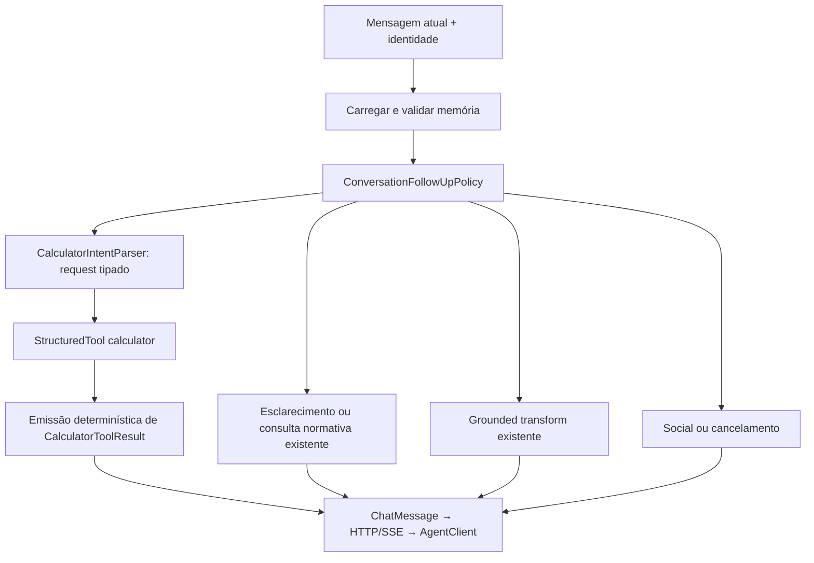

# Calculator + Tool Routing V1

Data: 31/10/2026, America/Sao_Paulo. Verificação local de engenharia, providers controlados, sem avaliação jurídica ou API real.

Os 60 casos técnicos conservaram a rota esperada (60/60); as 16 operações suportadas produziram o resultado matemático esperado (16/16). Perguntas normativas não chegaram à calculator (0/18); cálculos claros suportados não chegaram ao RAG (0/16). Houve zero tentativa externa em 43 mensagens de calculator observadas. Estes denominadores finitos não demonstram generalização linguística ou cálculo de prazo jurídico.

## 1. Objetivo

Acrescentar calculator determinística ao orquestrador conversacional, com resultado tipado e preservação de autoridade normativa. Sem planner/action router LLM, UI, Streamlit, deploy, autenticação, business days, feriados, composição automática RAG→calculator ou nova avaliação dos 44 casos.

## 2. Estado inicial

Branch `feat/conversation-memory-followups-v1`, HEAD `d827d4e275eba604aba5a84aa564507ce66349fb`, árvore limpa na inspeção inicial. Foram executados status, branch, rev-parse, log -15, diff, diff --cached e diff --stat antes de alterar código. A branch `feat/calculator-tool-routing-v1` foi criada desse HEAD. [initial_audit.json](initial_audit.json) distingue os campos observados da branch-fonte e a captura posterior à criação da branch/pasta de auditoria; o untracked dessa captura é somente a pasta nova de evidência.

## 3. Arquitetura antes

O adapter conversacional suportava social, cancelamento, esclarecimento pendente, apresentação derivada, mudança de domínio e consulta normativa. Cálculos não tinham rota própria nesse adapter. A calculator genérica legada não estava ligada ao grafo integrado.

## 4. Arquitetura depois

Os novos módulos são [calculator.py](../../../code/src/rag_baseline/calculator.py) e [calculator_contracts.py](../../../code/src/rag_baseline/calculator_contracts.py). Importar esses módulos não cria providers, storage ou relógio. Nenhuma dependência nova foi instalada.

## 5. Legacy calculator audit

`code/src/agents/tools.py`: `Calculator`, BaseTool por decorator, entrada `expression: str`, `numexpr.evaluate` com globals vazio e locais pi/e. Retorna string; erro levanta ValueError contendo entrada e exceção. Sem allowlist e limites explícitos na aplicação, sem datas e sem contrato de erro. A função não chama LLM/HTTP; o módulo agrega imports e helpers de integrações. Bindings em chatbot_generic e research_assistant. Nenhum teste dedicado foi encontrado pela busca. Decisão **DO_NOT_USE** no grafo novo; legado preservado byte a byte. [legacy_calculator_audit.json](legacy_calculator_audit.json).

## 6. Tool routing

Ordem: validação de memória → CLEAR_PENDING → SAFE_DIRECT → CALCULATOR → CONTINUE_CLARIFICATION → GROUNDED_TRANSFORM → CONTEXTUAL_NORMATIVE_RAG → NORMATIVE_RAG. AgentActionPolicy e grafo intra-turno anteriores permanecem intactos. A policy conversacional acrescenta somente a rota e as formas fechadas de apresentação numérica pedidas. Reason codes de calculator são constantes, sem raciocínio livre.

## 7. CalculatorIntentParser

Normaliza NFC, verifica veto normativo e exige forma de mensagem matemática/de datas. Prefixos fechados `Quanto é` e `Calcule` são opcionais. Intent e executabilidade são distintos: datas ambíguas/relativas e dias úteis claros são CALCULATOR + ERROR. Prosa arbitrária depois de prefixo não autoriza execução parcial. Datas literais isoladas seguem fallback ou esclarecimento pendente, para não virar divisão/subtração. `Resuma em 2 linhas` e `Explique em 3 passos` são transforms, não matemática.

## 8. CalculatorTool

StructuredTool `calculator`, input `CalculatorToolInput.request`, union discriminada de ArithmeticRequest, DateOffsetRequest, DateDifferenceRequest e RejectedRequest seguro. O parser constrói os parâmetros somente da mensagem atual. Não recebe histórico, answer, referências, provenance ou memória. No caminho de calculator, a tool é chamada uma vez e a facade zero vezes; spies e auditoria confirmam esse comportamento no escopo testado.

## 9. CalculatorToolResult

Contrato v1 com ANSWER/ERROR, operation_kind, content, normalized_input e payload exclusivo numeric_result/date_result/days_result. ERROR tem código fechado, safe_message e nenhum resultado numérico/data. Conteúdo é validado contra formatter determinístico. Não contém NormativeToolResult, referências, domínio, core_status ou autoridade normativa.

## 10. Arithmetic grammar

Descida recursiva: soma → produto → unário → número ou parênteses. Operadores +, -, *, /; sinais unários e precedência usuais. Sem potência, funções, variáveis executáveis, listas, strings, atributos, comprehensions ou shifts. Não utiliza eval, exec, shell, subprocess, sympy, asteval ou numexpr.

## 11. Numeric representation

Decimal, precisão 28, ROUND_HALF_EVEN, Emin=-100 e Emax=100 em contexto local independente. Ponto decimal somente; vírgulas, milhares e notação exponencial textual são rejeitados. `0.1+0.2` emite `0.3`; `1/3` tem arredondamento decimal de 28 dígitos. A validação de magnitude usa copy_abs para não herdar arredondamento do chamador. Não se declara aritmética racional exata.

## 12. Complexity limits

512 caracteres por mensagem/expressão; 128 tokens; 24 dígitos por literal; 16 níveis de agrupamento/unário. Magnitude intermediária/resultado até 1e24; expoente ajustado mínimo -100. Deslocamento absoluto até 3652058 dias, sujeito ao intervalo 0001–9999 de date. As verificações precedem operações/formatos excessivos. Testes incluem comprimento, dígitos, tokens, profundidade, magnitude e offset tipado enorme.

## 13. Unsafe expression handling

Erros são tipados e não expõem exceção ao cliente. Divisão por zero → division_by_zero. Funções/identificadores, código e operações fora da gramática são rejeitados. O dataset fechado recusou 11/11 expressões inseguras ou inválidas, além da divisão por zero contada separadamente. O teste com spy da tool bloqueia socket/HTTP e verifica uma chamada real à calculator e nenhuma à facade.

## 14. Date offset

Datas absolutas DD/MM/YYYY e YYYY-MM-DD. Formas fechadas: `adicione|some|subtraia N dia(s) corrido(s) a|de DATA` e `N dia(s) antes|depois de DATA`. Usa somente date ± timedelta; `05/11/2026 + 10` emite 15/11/2026. Testes de ano bissexto/não bissexto, datas inválidas e overflow. Não escolhe marco inicial jurídico.

## 15. Date difference

`Quantos dias [existem] entre DATA e DATA?` calcula date_b - date_a, com sinal. Conteúdo `Diferença entre as datas: 10 dias.` Não determina inclusão de extremos nem chama o resultado de prazo.

## 16. Ambiguous date rules

`10 dias a partir de 05/11/2026` → ERROR ambiguous_date_offset com pedido de formulação explícita de adição. Nenhuma escolha de dies a quo. Rejeição 2/2 no conjunto técnico, incluindo prefixo Calcule.

## 17. Business days e relative dates

Dias úteis → unsupported_business_days. Hoje/amanhã/ontem/próxima/fim do mês, quando em intent claro, → unsupported_relative_date. Não existe calendário, inferência segunda–sexta, feriados, recesso ou relógio na calculator.

## 18. Normative/calculator boundary

Marcadores normativos são veto conservador e não o único critério: a admissão matemática/de datas exige estrutura fechada. Perguntas sobre artigo, resolução, prazo, graduação, UFPI, marco, regra ou vigência seguem a capacidade normativa. Não extrai parâmetros de texto normativo, não interpreta norma e não executa metade de pedido misto. Resultados: 0/18 false routes normativas; 0/16 false routes dos cálculos suportados. A lista não demonstra reconhecimento universal de linguagem jurídica.

## 19. Pending clarification

SQLite em arquivo é fechado/reaberto antes dos cálculos. ANSWER `2+2` e ERROR `1/0` preservam pending e o envelope anterior; a resposta subsequente `graduação` continua a pergunta e UUID originais. Pending preservation 2/2 e correlation continuity 1/1. Cancelamento completo mantém a prioridade anterior.

## 20. Memory preservation

Calculator não grava em last_normative_result. Com memória anterior, 4/4 turnos conservaram modelo, envelope privado/audit, referências, provenance, questão, correlação, pending e stamp. Teste dedicado preserva memória stale sem permitir seu uso em transform. Memória inválida continua sujeita à validação anterior; nenhuma autoridade corrompida é reparada.

## 21. Grounded follow-up after calculator

Política explícita: calculator/social não substituem o último ANSWER normativo. `repita`, `explique mais simples` e resumo posterior podem usá-lo. O probe preservou UUID/referências/provenance, sem nova facade (1/1). Não há memória matemática; `E vezes 3?` é fallback conservador. Esta escolha pode surpreender UX.

## 22. Transport

ChatMessage.calculator_result é opcional e mutuamente exclusivo com normative_result e grounded_followup_result. Mensagem deve ser AI e preservar content exato. O projetor revalida resultado e recibo terminal de calculator; campos privados não entram no payload (0/72 vazamentos observados).

## 23. Service

O adaptador project_integrated_state foi estendido; service.py permanece byte a byte igual. Invoke usa projeção terminal; stream publica um message completo + DONE, inclusive stream_tokens=true, sem simular tokens. Identidade/namespace permanecem os anteriores. /history conserva as limitações legadas; não foi criado histórico específico de calculator.

## 24. Client

AgentClient permanece byte a byte igual. Schema compartilhado restaura CalculatorToolResult real. Testes cobrem invoke/stream sync com HTTP controlado e ainvoke/astream via ASGI real; probes de transporte 2/2 e acordo invoke/stream 1/1. SSE bruto confirma message + DONE 1/1.

## 25. Concurrency

Execução simultânea A=2+2, B=consulta normativa metadata_exact, C=date offset. A/B/C possuem namespaces distintos; resultados e memória permaneceram separados (1/1 grupo). B usa Router, retrieval metadata_exact e núcleo reais com provider controlado e dez chunks temporários; houve somente um roteamento, sem embeddings. Esse índice temporário não é avaliação de relevância do índice completo. Sem garantia de turnos simultâneos da mesma identidade, benchmark de carga ou concorrência distribuída.

## 26. Probes

[technical_protocol.json](technical_protocol.json) congelou 14 grupos e 10 hashes de código, testes, dataset e harness antes da execução. [local_probes.py](local_probes.py) realizou uma execução integral com journal imediato, transportes externos bloqueados e exceção somente para ASGI local. Não houve alteração de parser, harness ou expectativas depois do congelamento. [probe_rows.jsonl](probe_rows.jsonl) tem 72 registros; [local_probes.json](local_probes.json) confirma hashes inalterados e zero tentativa externa. Dataset: [tool_routing_calculator_v1.json](../../datasets/tool_routing_calculator_v1.json), 60 casos sem gold jurídico. Sequências, concorrência e transporte são adicionais e não inflam o denominador de routing.

## 27. Metrics

| Métrica técnica | Numerador/denominador |
|---|---:|
| Tool Routing Accuracy | 60/60 |
| Tool Call Count Agreement | 60/60 |
| Calculator Execution Accuracy | 16/16 |
| Calculator-to-Normative Route Avoidance | 16/16 |
| Private Field Exclusion | 72/72 |
| Calculator External Call Avoidance | 43/43 |
| Unsafe Expression Rejection Rate | 11/11 |
| Ambiguous Date Rule Rejection Rate | 2/2 |
| Normative-to-Calculator Route Avoidance | 18/18 |
| Calculator Memory Preservation Rate | 4/4 |
| Pending Preservation Rate | 2/2 |
| Clarification Correlation Continuity | 1/1 |
| Grounded Follow-up Source Preservation | 1/1 |
| Concurrent Result Isolation | 1/1 |
| Typed Calculator Transport Preservation | 2/2 |
| Invoke/Stream Calculator Agreement | 1/1 |
| SSE Complete Message and DONE | 1/1 |

False route counts: normativa→calculator **0/18**; calculator suportada→normativa **0/16**. External Call Count: **0/43** mensagens de calculator; a métrica de avoidance é o complemento 43/43. Não somar seleções/denominadores sobrepostos.

## 28. Negative results

RED inicial real: 11 failed, 7 passed, 83 erros de fixture por componente ausente. GREEN inicial: 101 passed. Auditoria numérica reproduziu 1 failed/94 passed; revisão de fronteiras reproduziu 7 failed/95 passed; correções terminaram em 111 novos testes aprovados. [review_findings.json](review_findings.json) registra achados, correções e limites, sem transcrições. A revisão independente antecedeu as correções; elas foram verificadas por regressões e suíte, sem segunda revisão.

Antes dos probes: falha do executor isolado; launcher Python do venv apontava para instalação ausente; Python standalone não encontrava pytest até receber os site-packages existentes; launcher python -m ruff não encontrava binário, substituído pelo executável Ruff existente. Snapshot inicialmente encontrou nomes Git escapados, corrigido com ls-files -z. Esses incidentes não são falhas omitidas do protocolo congelado. Nenhuma dependência foi instalada ou API real acessada.

Na verificação final, Ruff iniciado na raiz classificou imports de src de modo diferente do projeto code/. A captura inicial permanece em verification_initial.json e ruff_check_initial.txt. Os checks finais usam code/ para produto/testes e a raiz para scripts de evidência, com o mesmo pyproject. Somente ferramentas de verificação foram ajustadas; os dez hashes congelados, o harness dos probes e as expectativas não mudaram. A suíte completa já estava verde; os checks estáticos foram repetidos, sem repetir probes ou testes desnecessariamente.

Ao preparar o commit, git diff --cached --check inicialmente tratou o CR das capturas Windows como whitespace. A regra local whitespace=cr-at-eol reconhece esses finais de linha junto de -text, preservando os stdout originais; não desativa a checagem de outros espaços. Os checks staged e unstaged finais passaram.

## 29. Limitations

Gramática pequena de português, possíveis false negatives e false positives, rejeição conservadora de prosa mista e prefixo social, operações matemáticas fora do conjunto recusadas. Não cobre porcentagem, potência, funções, moeda, unidade, estatística ou álgebra. Datas isoladas são reservadas para fallback; continuidade matemática não existe. Decimal arredonda divisões recorrentes. Providers e outputs de apresentação controlados não medem qualidade linguística/jurídica, autenticação ou prontidão de produção. As limitações científicas do V2 e os resultados anteriores dos 44 casos permanecem inalterados; os casos não foram reexecutados.

## 30. Future normative + calculator composition

Trabalho futuro exigiria contrato específico com parâmetros autorizados estruturados, incluindo marco e regra de contagem. Não foi implementado. Texto livre do answer jamais foi promovido a input de cálculo nesta V1.

## 31. Decisions e execução

[decision_log.jsonl](decision_log.jsonl): 18 decisões sobre legado, parser, gramática, Decimal, limites, datas, ambiguidade, fronteiras, prioridade, pending, memória e transporte. [execution_log.jsonl](execution_log.jsonl): 27 eventos observáveis. recorded_at é o momento de consolidação; timestamps específicos de testes e congelamento estão nos próprios artefatos.

## 32. Preservation

[preservation_before.json](preservation_before.json) e [preservation.json](preservation.json): **739 arquivos iniciais, 735 idênticos e quatro mudanças autorizadas**: conversation_policy.py, conversation_graph.py, schema.py e normative_transport.py. Os testes/módulos novos não existiam no snapshot inicial. Contrato ConversationNormativeMemory, grounded transformer, builder legado, facade/tool, NormativeToolResult, Router V1/V2, Temporal Intent, dense/metadata_exact/vector_filtered, Version Filter, grounding, Structured Output V2, registry normativo, registry/default, service.py, client e resultados anteriores permanecem byte a byte iguais. [contract_checks.json](contract_checks.json) também compara AST de componentes preservados.

Os **507 IDs/documentos/metadados/embeddings float32** conservam snapshot SHA-256 `ab253a24b756d9f3d3e05aeb49220798b08d947704112327fd894a577bb2b38a`. Sem reindexar, atualizar metadata ou re-embedding. DEFAULT_AGENT continua chatbot_ufpi_v2; integrado não registrado. A regra -text é local à pasta nova de resultados. [manifest.json](manifest.json) distingue hashes de working files/blobs quando finais de linha diferem.

## 33. Tests

[test_results.json](test_results.json) registra comandos, cwd, timestamps, status e contagens reais; stdout integrais acompanham cada seleção. Seleções sobrepostas não são somáveis.

| Seleção | Resultado real |
|---|---|
| calculator | 111 passed, 2 warnings in 9.27s |
| conversation_memory | 89 passed, 2 warnings in 15.06s |
| memory | 2 passed in 0.20s |
| transport | 51 passed, 2 warnings in 9.24s |
| agent | 61 passed in 2.51s |
| retrieval | 76 passed in 11.31s |
| facade | 79 passed in 0.61s |
| structured | 122 passed in 2.13s |
| temporal | 93 passed in 4.63s |
| rag_baseline | 873 passed, 10 skipped, 2 warnings in 46.60s |
| service | 24 passed, 3 warnings in 0.40s |
| client | 9 passed, 1 warning in 0.12s |
| legacy_app_integration | 7 passed, 2 skipped in 1.73s |
| legacy_core | 23 passed in 5.63s |
| full | 938 passed, 12 skipped, 4 warnings in 50.64s |

Ruff check e format-check aprovados para os arquivos Python criados/tocados; git diff --check exit 0, conforme [verification.json](verification.json). Os warnings completos são legados (dependências Pydantic, AsyncMock/client e timeout TestClient). Skips opt-in/integração legados permanecem. Não houve frontend ao vivo ou API externa.

## 34. Commits

1. `55e4f0a` — test: define calculator and tool routing boundaries.
2. `a5d2f9e9872b10e880f4eaf6166fe709b9338f06` — feat: add deterministic calculator routing.
3. Evidências — test: verify calculator isolation and transport; o SHA final não consta aqui, pois o relatório não pode incorporar o hash do próprio commit.

Tudo permanece local em feat/calculator-tool-routing-v1. Sem push, pull, merge, rebase, reset ou limpeza destrutiva; sem mudança de default, UI, deploy, autenticação, tuning V2, APIs reais, composição jurídica ou artefatos de processo de IA. A entrega termina nesta calculator e no roteamento controlado, aguardando a próxima etapa definida pelo usuário.
