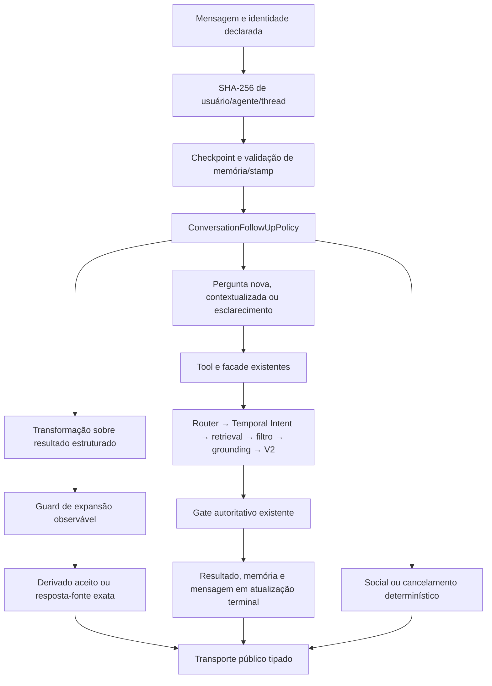

# Conversation Memory & Grounded Follow-ups V1

Data: 31/10/2026, America/Sao_Paulo. Verificação local de engenharia com providers controlados, sem avaliação jurídica ou APIs reais.

A memória normativa foi restaurada após reabrir SQLite em **2/2 casos**. As identidades compostas testadas não compartilharam autoridade: **0/6 vazamentos** nos cenários de isolamento e concorrência. Cinco transformações preservaram correlação, referências e provenance sem nova consulta; dois transportes HTTP/SSE conservaram o resultado derivado tipado. Uma mudança explícita para pós-graduação executou novamente Router, retrieval e núcleo, com evidência nova.

São **89 testes novos** e **827 passed / 12 skipped** na suíte completa. Os **507 registros** permanecem idênticos. Estes resultados finitos não demonstram autenticação, equivalência semântica de toda reformulação, qualidade jurídica ou prontidão para produção. O agente continua fora do registry público e não-default.

## 1. Objetivo

Persistir autoridade normativa estruturada por identidade declarada, continuar esclarecimentos e permitir apresentação derivada sem nova recuperação. Mensagens, memória normativa e evidência continuam objetos distintos. Não foram implementados calculator, Streamlit, autenticação, deploy ou novo experimento dos 44 casos.

## 2. Estado inicial

Branch `feat/typed-normative-transport-v1`, HEAD `01b95c5f84c785cf80d1fbc3ae0e02b269027a2d`, árvore limpa. [initial_audit.json](initial_audit.json) registra status, branch, HEAD, 15 commits e diffs. A branch `feat/conversation-memory-followups-v1` foi criada exatamente desse HEAD. O anexo reenviado é idêntico ao anterior; o pedido de continuar preservou o mesmo escopo.

## 3. Arquitetura anterior

O grafo integrado resolvia somente o turno atual, com uma capacidade normativa e emissão terminal autoritativa. O transporte conservava NormativeToolResult, mas não havia memória privada conectada, esclarecimento entre turnos ou contrato derivado. O checkpoint legado usava thread_id sem namespace composto.

## 4. Arquitetura depois

São quatro módulos novos em `rag_baseline`: [contracts](../../../code/src/rag_baseline/conversation_contracts.py), [policy](../../../code/src/rag_baseline/conversation_policy.py), [transform](../../../code/src/rag_baseline/conversation_transform.py) e [graph](../../../code/src/rag_baseline/conversation_graph.py). Não há IO ou provider construído no import desses módulos.

## 5. ConversationIdentity

Contém user_id, agent_id e thread_id estritos, não vazios. A identidade também fica na memória e é revalidada na restauração. Uma chave física correspondente a outra identidade é recusada antes de chamar a facade. O serviço obtém agent_id do path selecionado; um campo homônimo no body não substitui essa seleção.

## 6. Ownership e isolamento

Usuário, agente ou thread diferentes produzem namespaces diferentes. Os testes verificam último resultado, pendência, correlação e referências. Os probes incluem respostas estrangeiras inacessíveis e continuação de uma pendência simultânea a consulta fresca de outra identidade. A aplicação não usa um cache global de último resultado.

## 7. Limite: não é autenticação

user_id continua fornecido pelo cliente. A implementação oferece isolamento lógico de namespace baseado na identidade declarada. Não autentica o proprietário, não impede impersonation e não acrescenta autorização de acesso. Conhecer e declarar a mesma identidade continua fora da proteção oferecida por esta V1.

## 8. Storage key e identificadores

A chave interna é SHA-256 de um array JSON canônico contendo versão de namespace, usuário, agente e thread. Não usa Python hash nem concatenação ambígua. O serviço coloca essa chave somente no configurable.thread_id interno. O thread_id público permanece intacto; correlation_id e run_id continuam distintos. Campos privados de checkpoint em agent_config são recusados no caminho conversacional.

## 9. Memory contract

ConversationNormativeMemory contém memory_version, conversation_identity, last_normative_question, last_normative_result_persistence, last_normative_correlation_id, pending_clarification e compatibility_stamp. Não duplica a lista de mensagens. Somente ANSWER completo pode ocupar o último resultado reutilizável; questão e correlação precisam ser coerentes com o envelope.

## 10. Persistence envelope

O resultado entra pela operação existente `to_persistence()` e sai por `from_persistence()`, com validação. Dois testes com JsonPlusSerializer mostram a perda do audit excluído no roundtrip público e sua preservação pelo envelope explícito. O envelope não é transportado ao client. Corrupção resulta em INVALID/memory_invalid, sem tentativa de reparar autoridade; uma pergunta completa pode iniciar consulta fresca.

## 11. Compatibility stamp e fingerprints

O stamp contém memory_version, core_version, contract_version, corpus_fingerprint e registry_fingerprint. `build_memory_stamp` calcula o snapshot lógico do índice existente e SHA-256 do JSON canônico do registry na criação das dependências, sem embeddings. O builder recebe esse valor pronto; follow-ups não releem o corpus.

O fingerprint medido dos 507 registros é `ab253a24b756d9f3d3e05aeb49220798b08d947704112327fd894a577bb2b38a`; o registry canônico produziu `fbd017d0f080481bb0f89e6809b48a87317d8fc97909e7ec2d40f8240bff25ef`. Não são literais usados para decidir compatibilidade na implementação. No harness, o stamp do índice protegido funciona como fixture de compatibilidade; a busca do probe de núcleo usa separadamente dez chunks temporários controlados, sem afirmar equivalência com o índice completo.

## 12. Stale memory

Diferenças nas cinco dimensões produzem STALE e stale_reason. Nenhuma versão da resposta antiga é atualizada silenciosamente. Transformação dependente de memória incompatível recebe texto determinístico pedindo a pergunta original, sem resultado/provenance antigos no payload. Uma consulta fresca concluída substitui a memória por novo resultado com stamp corrente. Envelope inválido é INVALID antes da comparação de compatibilidade, pois não é autoridade restaurável.

## 13. Checkpointer e atomicidade

`build_integrated_graph` aceita checkpointer, memory_stamp e transformer opcionais. Com stamp, delega ao adapter conversacional; sem ele, o corpo anterior permanece com AST idêntica. Um checkpointer sem stamp é recusado. SQLite não é criado no import e não há singleton de memória.

Mensagem final, resultado e atualização de memória são retornados no mesmo nó terminal, depois do gate. Tool receipt, ToolMessage e draft não são checkpoints intermediários da conversa. Campos transitórios são limpos a cada entrada. Erro terminal conserva o último ANSWER válido e limpa a pendência; cancelamento da execução propaga e não substitui a autoridade anterior.

## 14. SQLite persistence

Testes e probes usam AsyncSqliteSaver real em arquivo temporário, fechando e reabrindo a conexão antes do segundo turno. ANSWER e pending sobrevivem ao reinício lógico. A igualdade inclui envelope privado e audit restaurado. Postgres/Mongo foram auditados como factories existentes, mas não iniciados ou validados nesta implementação.

## 15. PendingClarification

Registra original_question, clarification_question, correlation_id e stamp. CLARIFICATION mantém a pergunta original e não fabrica answer, referências ou provenance. Uma nova CLARIFICATION conserva a identidade da operação e atualiza somente a pergunta de esclarecimento.

## 16. Continuação de clarification

O próximo turno substantivo chama a mesma facade com pergunta original, clarification atual e correlação original. Não recebe scope, sector ou manual_scope. Um adapter local injeta somente esse esclarecimento autorizado pelo pai, preservando o schema estreito da tool anterior. Um teste com Router V1 real/controlado verifica esses campos, zero embedding/geração na primeira pergunta ambígua e ANSWER na continuação.

ANSWER limpa pending e salva last_normative_question original. ERROR terminal limpa pending sem apagar o último ANSWER válido. O probe de continuidade usa facade controlada; o teste do Router verifica separadamente a integração real do núcleo.

## 17. Social e cancelamento durante pending

A lista social continua sendo a AgentActionPolicy existente. “Obrigado” não consome esclarecimento nem chama a facade. Comandos completos cancelar, cancele, esquece, deixa pra lá e deixa para lá limpam somente pending e preservam o último resultado. Não são comandos globais para apagar histórico ou corpus. Sem pending, seguem o comportamento conservador de consulta.

## 18. Follow-up policy

Policy determinística com SAFE_DIRECT, CLEAR_PENDING, CONTINUE_CLARIFICATION, GROUNDED_TRANSFORM, CONTEXTUAL_NORMATIVE_RAG e NORMATIVE_RAG. A ordem é compatibilidade, cancelamento de pending, social, continuação pendente, transformação, domínio e nova consulta. Não usa LLM para decidir ação, domínio ou temporalidade. Domínio final continua responsabilidade do Router.

## 19. Grounded transform

A lista fechada reconhece repita, explique melhor, explique mais simples, em outras palavras, resuma e resuma isso, com normalização limitada. Pedidos mistos/substantivos voltam à facade. O transformer recebe pedido, answer, referências oficiais, provenance pública e fatos autorizados. Não recebe histórico integral, chunks, corpus, retrieval ou tools. É uma dependência injetável; não foi acrescentado provider remoto ou modelo padrão de apresentação.

## 20. GroundedFollowUpResult

Contrato público separado, versão 1, com kind, content, source_correlation_id, versões da fonte, referências, temporal_provenance, domain e guard_status. Não sobrescreve NormativeToolResult.answer. Referências e provenance são copiadas estruturalmente, sem reconstrução textual. O resultado normativo original permanece no envelope privado sem mutação.

## 21. Guard de transformação

Guard determinístico separado do Structured Output V2. Compara identificadores normativos, resolução inclusive sem ano, artigos, parágrafos, incisos, alíneas, caput, numerais, datas de calendário, anos cronológicos e classes temporais explícitas. O ano de um identificador documental não autoriza automaticamente seu uso como ano cronológico. Reconhece as formas delimitadas testadas de listas, pontuação, n.º, aspas e parênteses.

Novas cláusulas temporais observáveis são recusadas em vez de inferir equivalência com uma negação da fonte. Isso pode rejeitar paráfrases corretas. Não prova equivalência semântica, não reconhece toda linguagem jurídica e pode deixar passar regra nova sem marcador observável. Não se alterou o guard V2 nem se declara eliminação de alucinações.

## 22. Repeat

“Repita” emite exatamente o answer da fonte, inclusive CRLF/espaços, sem transformer ou facade. Preserva referências, provenance e correlação. Mensagem textual anterior adulterada não altera essa emissão: há regressão explícita que injeta texto fictício no MessagesState e confirma uso do envelope normativo.

## 23. Rephrase

Reformulação faz no máximo uma chamada ao provider injetado. Se ausente, falhar ou expandir conteúdo detectado, emite o answer original com FALLBACK_TO_SOURCE, sem retry. A fonte core_status=fallback não é enviada ao transformer. O motivo source_core_fallback fica no audit privado.

## 24. Summary

Resumo usa a mesma fronteira de apresentação e o mesmo guard; não há avaliação de qualidade do resumo fake. Os cinco transforms primários tiveram zero nova facade/retrieval e preservaram fonte. Os dois cenários extras de transporte são reportados separadamente, sem aumentar artificialmente esse denominador.

## 25. Domain shift

“E na pós?”, “E na pós-graduação?”, “E na graduação?” e “E para ambos?” acionam nova operação quando o tema pode ser resolvido. Têm nova correlação e nova execução da facade. Não reutilizam answer anterior como resposta ao outro domínio.

## 26. Contextual query resolver

Remove somente marcadores conhecidos na/da/para graduação ou pós-graduação e acrescenta o domínio pedido à pergunta temática. Não faz NLP geral. Perguntas anteriores com norma/artigo explícitos ou qualificadores que não podem ser removidos com segurança recebem pedido determinístico de pergunta completa; não se mapeia dispositivo entre normas.

No probe com núcleo real/controlado, “Posso cancelar uma disciplina na graduação?” → “E na pós?” produziu pergunta canônica para pós, dois roteamentos, nova correlação e referências sem a norma de graduação. Os vetores 2D controlados desse probe não medem relevância semântica.

## 27. New topic e elipses temporais

Nova pergunta substantiva chama RAG fresco. “E atualmente?” ou “E antes da alteração?” não têm resolução temporal ampla: seguem ao núcleo como nova pergunta, sujeito a esclarecimento. A lista fechada não entende qualquer follow-up; isso é limite deliberado desta V1.

## 28. Transporte

ChatMessage ganha grounded_followup_result opcional. Valida exclusão mútua com normative_result, mensagem AI e content exato do derivado. A regra de conteúdo autoritativo do resultado normativo anterior continua válida. DIRECT tem ambos nulos. Nenhum envelope privado, stamp, storage key ou audit entra no payload.

## 29. Service behavior

O serviço deriva identidade de usuário/thread declarados e agente selecionado pelo path. Recusa checkpoint_id, checkpoint_ns, checkpoint_map, storage_key e conversation_identity em agent_config no caminho novo. O adapter reconhece o grafo confiável configurado na aplicação; o cliente não ativa memória escolhendo flag de transporte.

Invoke projeta somente o estado terminal; SSE conserva um message completo e DONE, mesmo com stream_tokens=true. Não publica valores intermediários do checkpoint. /history permanece legado, ligado ao default e sem reconstrução de memória/resultado derivado persistidos; não foi anunciado suporte conversacional integrado nesse endpoint. Lifespan, history, feedback, info e health_check conservam AST idêntica.

## 30. Client behavior

O client anterior permanece byte a byte igual. Seu parser de ChatMessage restaura o modelo derivado tipado automaticamente. Testes cobrem invoke/stream sync por HTTP controlado e ainvoke/astream pelo ASGI real. Os probes HTTP/SSE são assíncronos e preservaram 2/2 derivados completos. Não foi alterado Streamlit nem foi criado rendering novo.

## 31. Concorrência

Testes/probes executam usuários A/B na mesma thread pública, threads X/Y do mesmo usuário e pendência A simultânea a query fresca B. Memórias e correlações ficaram distintas nos casos controlados. Não há benchmark de carga, exclusão mútua de turnos concorrentes da mesma identidade ou garantia distribuída. O serviço instalado continua sem registrar o agente; a evidência HTTP usa injeção confiável no harness.

## 32. Protocolo, probes e métricas

[technical_protocol.json](technical_protocol.json) congelou 18 grupos, expectativas e 13 hashes antes da execução. [local_probes.py](local_probes.py) bloqueia transportes HTTP externos, grava cada resultado imediatamente e verifica os hashes antes/depois. Todos os grupos foram executados uma vez integralmente; não houve alteração produtiva, ajuste do harness ou reinício seletivo após o congelamento. [probe_rows.jsonl](probe_rows.jsonl) e [local_probes.json](local_probes.json) contêm 22 resultados, incluindo os pares concorrentes e os transportes adicionais.

| Métrica | Numerador/denominador | Unidade |
|---|---:|---|
| Memory Restore Rate | 2/2 | ANSWER e pending após reopen |
| Cross-User Isolation | 1/1 | autoridade estrangeira inacessível |
| Cross-Agent Isolation | 1/1 | agente diferente |
| Cross-Thread Isolation | 1/1 | pending de outra thread não consumido |
| Clarification Continuity | 1/1 | pergunta original + esclarecimento |
| Clarification Correlation Preservation | 1/1 | UUID original |
| Grounded Transform Retrieval Avoidance | 5/5 | transforms primários |
| Grounded Transform Source Preservation | 5/5 | UUID, referências e provenance |
| Transform Expansion Block | 1/1 | fake acrescenta data |
| Contextual RAG Re-entry | 1/1 | domínio pós e nova operação |
| Stale Memory Rejection | 1/1 | transform sem autoridade antiga |
| Typed Follow-up Transport | 2/2 | invoke/stream com AgentClient |
| Memory Leakage Count | 0/6 | isolamento e concorrência |
| Private Memory Field Leakage | 0/22 | payloads públicos |

As demais formas do guard, cinco dimensões de incompatibilidade, repetição de clarification, erros, cancelamento da execução e corrupção têm testes dedicados; não são denominadores extras desses probes. O [dataset técnico](../../datasets/conversation_followups_v1.json) contém as expectativas explícitas, sem gold jurídico.

## 33. TDD, revisão e resultados negativos

RED inicial: 45 falhas esperadas por ausência da fronteira de memória; commit local antes da implementação. Novo RED de transporte/guard: 15 falhas e dois sucessos de serializer. Primeiro bloco conjunto posteriormente passou 62; a composição com contratos anteriores passou 174.

Revisão reproduziu locators com aspas/parênteses/numeração, resolução sem ano e expressões temporais. Os ciclos adicionais registraram 12, três e três falhas esperadas, depois correção. A revisão final confirmou bloqueio dos repros e não deixou Important/Critical no escopo inspecionado. [review_findings.json](review_findings.json) registra achados públicos, sem transcrição de agentes.

Na implementação, a detecção inicial do grafo por get_input_schema().model_fields não funcionou porque o framework usa RootModel; foi substituída pela inspeção do input schema do builder após falhas HTTP. Um mock sync interceptava somente httpx.Client, mas os helpers usam outro binding: houve tentativa de resolver o host sintético test e falha DNS, sem API real; o teste foi corrigido para interceptar o transporte. Uma seleção completa a partir da raiz não resolveu imports tests; a execução correta em code/ passou. A auditoria AST corrigiu o nome health_check e a seleção do corpo legado. Essas ocorrências antecedem os probes congelados e não são falhas omitidas do núcleo.

Permanecem falsos positivos possíveis de guard, expressões fora das listas fechadas, dependência de identidade declarada, ausência de transporte persistente em /history e de runtime público registrado. Nenhum resultado novo corrige as lacunas científicas do V2.

## 34. Limitações

Providers de consulta/apresentação controlados, SQLite temporário e dataset finito. Não houve usuários, LLM real, qualidade jurídica, avaliação linguística do resumo, relevância de retrieval, servidor externo, autenticação, PostgreSQL/Mongo ao vivo, TTL, política de retenção, carga ou deploy. A configuração do saver é responsabilidade do runtime que injeta dependências; registrar publicamente o agente exige etapa própria.

O núcleo V2 conserva suas limitações conhecidas, incluindo cronologia documental ampla final 7/44 no experimento anterior. Os 44 casos não foram reexecutados. Apresentação derivada não é nova certificação normativa, e aceitação lexical não comprova preservação semântica integral.

## 35. Decisões e execução

[decision_log.jsonl](decision_log.jsonl) contém 18 decisões públicas sobre identidade, envelope, compatibilidade, esclarecimento, ações, guard, consulta contextual, checkpoint, transporte e history. [execution_log.jsonl](execution_log.jsonl) contém 27 eventos observáveis. Os registros consolidam fatos e efeitos verificáveis.

## 36. Preservação

[preservation_before.json](preservation_before.json) e [preservation.json](preservation.json) verificam **692 arquivos iniciais: 688 idênticos e quatro alterações autorizadas**: agent_graph.py (delegação opcional), schema.py (contrato derivado), normative_transport.py (projeção/identidade) e service.py (namespace e entrada). Não se afirma que esses quatro arquivos ficaram intactos.

Router V1/V2, Temporal Intent, dense, metadata_exact, vector_filtered, Version Filter, grounding, Structured Output V2, NormativeToolResult, facade, tool, action policy, gate normativo, registry/default, registry normativo, client e todos os resultados anteriores permanecem byte a byte iguais. O corpo legado do builder e as funções de serviço fora da intervenção têm verificações AST em [contract_checks.json](contract_checks.json).

Os **507 IDs, documentos, metadados e embeddings float32** são idênticos ao snapshot inicial, SHA-256 `ab253a24b756d9f3d3e05aeb49220798b08d947704112327fd894a577bb2b38a`. Não houve reindexação, metadata update ou re-embedding. A regra -text aplica-se somente à pasta nova de resultados. O manifest distingue hashes de working files e blobs quando finais de linha diferem.

## 37. Verificações finais

[test_results.json](test_results.json) e os stdout pytest registram comandos, cwd, timestamps e contagens reais. Seleções sobrepostas não devem ser somadas.

| Seleção | Resultado |
|---|---:|
| Novos focused conversation memory | 89 passed |
| Typed transport anterior | 51 passed |
| Agent integration anterior | 61 passed |
| Retrieval strategies | 76 passed |
| Facade/contracts | 79 passed |
| Structured Output V1/V2 | 122 passed |
| Cinco arquivos temporais | 93 passed |
| rag_baseline | 762 passed, 10 skipped |
| tests/memory | 2 passed |
| Service legado | 24 passed |
| Client legado | 9 passed |
| App/integration legados | 7 passed, 2 skipped |
| Core legado | 23 passed |
| Suíte completa | 827 passed, 12 skipped |
| Ruff check / format-check, 12 Python | aprovados |
| git diff --check | exit 0 |

Os quatro warnings completos são legados: dois Pydantic de dependência, AsyncMock no client e timeout de Starlette TestClient. Docker opt-in permaneceu skipped; AppTest usa harness isolado, sem frontend ao vivo. [verification.json](verification.json), [manifest.json](manifest.json) e [ARTIFACTS.json](ARTIFACTS.json) registram o conteúdo final; ARTIFACTS exclui a si próprio.

## 38. Commits e entrega local

1. `4f7dfda` — `test: define conversation memory and follow-up boundaries`.
2. `8e5247942ba9e4c622fc29e5de3800caab4d7863` — `feat: persist normative memory and grounded follow-ups`.
3. Evidências — `test: verify conversational isolation and grounded continuation`; o SHA final não consta aqui, pois não pode integrar seu próprio conteúdo.

Sem push, merge, rebase, pull, reset ou limpeza destrutiva. Default permanece chatbot_ufpi_v2; agente integrado não registrado. Sem autenticação alegada, calculator, Streamlit, deploy, API real, novo tuning V2 ou artefatos de processo de IA. A entrega termina nesta memória e nos follow-ups controlados, sem iniciar a próxima etapa.
