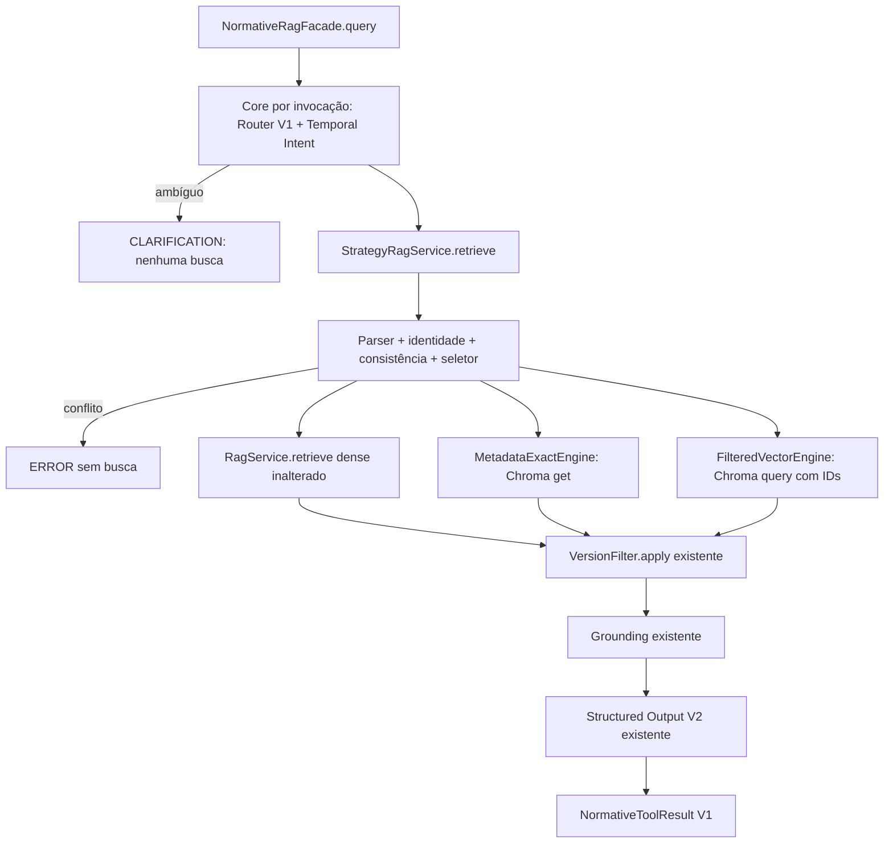

# Retrieval Strategies V1 — integração estrutural e semântica

Data: 31/10/2026. Verificação local de engenharia, sem LLM real, estudo de qualidade de resposta ou reexecução dos 44 casos.

Foram implementadas **dense_vector**, **metadata_exact** e **vector_filtered** como estratégias internas da NormativeRagFacade. A assinatura da facade e o schema público de NormativeToolResult V1 permanecem idênticos. O dense delega ao método anterior; metadata localiza norma/artigo sem embedding; filtered restringe IDs canônicos antes do top-k no Chroma.

Resultado: **76 testes novos**, **626 passed / 12 skipped** na suíte completa, 15 probes offline e snapshot dos **507 registros idêntico**. No conjunto técnico: seleção 24/24, resolução estrutural 7/7, pureza filtrada 15/15, preservação dense 2/2 e ausência de embedding em metadata 7/7. Esses números não medem correção jurídica ou qualidade geral de retrieval.

## 1. Objetivo

Preservar busca semântica e estrutural dentro da capacidade normativa, mantendo o mesmo pipeline temporal e a mesma saída estruturada. As estratégias apenas localizam candidatos; não decidem vigência nem geram resposta. Não há tool registrada, integração conversacional ou mudança de default.

## 2. Estado inicial

Branch verificada: `feat/normative-tool-facade-v1`. HEAD: `367e27f9d395aa8de75d17ffa433d718184630b6`. Árvore limpa. [initial_audit.json](initial_audit.json) registra status, branch, HEAD, 15 commits, diffs e stat.

Branch local criada exatamente desse HEAD: `feat/retrieval-strategies-v1`. O primeiro anexo terminava no início da seção 34; a continuação completa foi recebida antes de qualquer alteração de arquivo. A implementação segue o anexo completo.

## 3. Baseline congelado

Permanece Router V1 → Temporal Intent → retrieval → Version Filter → TemporalGroundingContext → Structured Output V2. Não houve mudança de prompts, guard, Content Locator Policy, display policy, renderer, retry ou fallback.

Os resultados anteriores V2 continuam preservados, incluindo conclusão 42/44, fallback 2/44 e cronologia documental ampla final 7/44. Não foram medidos novamente. A seleção das novas estratégias não corrige essas limitações.

## 4. Arquitetura antes

NormativeRagFacade construía AgenticRagService com RagService diretamente; toda recuperação usava RagService.retrieve dense. A facade já impunha roteamento automático e filtro obrigatório, e o contrato já previa os três nomes de estratégia.

## 5. Arquitetura depois

O adapter e RetrievalExecution são criados por invocação. Não há monkeypatch produtivo, método substituído globalmente ou filtro compartilhado mutável. generate e demais operações continuam delegados ao serviço original. Código novo: [retrieval_policy.py](../../../code/src/rag_baseline/retrieval_policy.py), [retrieval_engines.py](../../../code/src/rag_baseline/retrieval_engines.py) e [retrieval_service.py](../../../code/src/rag_baseline/retrieval_service.py).

## 6. Parser de referência

NormativeQueryReferenceParser é determinístico, sem LLM/embedding. Reconhece número/ano com ou sem texto Resolução/nº, 1.056/2026 e 1056/2026, art./art/artigo, maiúsculas e ordinal. A forma canônica é validada contra os identificadores efetivos do registry; zeros iniciais de norma não são removidos para inventar identidade.

O resultado conserva referências raw, normas reconhecidas, artigos, unknown_norm, ambiguidade e existência de conteúdo semântico restante. Um único par precisa estar vinculado em janela limitada, sem fronteira de cláusula. Não há norma inferida de setor, histórico, tamanho de documento ou embedding.

Listas, intervalos e expressões plurais são conservadoramente ambíguas. As regressões cobrem e/ou, vírgula, slash, &, hífen, en/em dash, seguintes e formas fracionárias/sufixadas não suportadas. Isso impede truncar os exemplos testados para o primeiro artigo. Não é parser jurídico geral.

## 7. Identidade normativa

NormativeIdentityResolver usa somente estrutura:

1. norm_id explícito válido no registry;
2. prefixo estável de chunk_id antes de -art-, validado no registry;
3. source exata registrada;
4. UNKNOWN se não resolver.

Evidências estruturais válidas que discordam entre si ou setor incompatível produzem conflito, sem escolher arbitrariamente uma norma. O registry fornece identidade/fontes/setor; status, relações e datas não participam da resolução ou ranking. Metadados não são alterados.

## 8. Metadados reais dos 507 registros

Todos possuem source, sector, article_number, article_label e original_index. norm_id/normative_status estão explícitos em 69; ausentes em 438. Não há metadata validada de parágrafo/inciso/caput.

O resolver reconheceu **507/507**: 69 por metadata e 438 por chunk_id. Há quatro sources exatas, cada uma associada a uma norma: 177/2012 com 376 registros; 956/2025 com 62; 658/2024 com 67; 1056/2026 com dois. Graduação soma 378; pós, 129. O caminho source também possui teste unitário próprio.

[identity_inventory.json](identity_inventory.json) registra cardinalidades e correspondência de todas as fontes atuais. A filtragem final usa IDs resolvidos, evitando presumir norm_id universal ou depender apenas de variantes textuais de source.

## 9. Seletor final

| Condição estrutural | Estratégia |
|---|---|
| uma norma conhecida + um artigo unambiguamente vinculado | metadata_exact |
| uma norma conhecida + nenhum artigo suficiente + tema semântico restante | vector_filtered |
| demais casos, múltiplas referências ou ambiguidade | dense_vector |

Consistência com o router é verificada separadamente. Norma sem tema/artigo não força filtered. Artigo sem norma não força exact. Uma expressão plural não é tratada como um único artigo, mesmo quando o parser só reconhece seu prefixo.

## 10. Dense vector

O adapter chama **RagService.retrieve existente**, com a mesma pergunta, sector, excluded_sources e query_embedding. O método original e ChromaVectorStore permanecem byte a byte iguais; não foram alterados embedding model, top_k, cosine, coleção ou ranking.

Fixtures com escopo único e ambas verificam equivalência da resposta/referências; o teste direto do adapter compara candidatos completos, ranks e distâncias, incluindo embedding pré-computado. Nos probes, dois conjuntos de IDs/ranks/distâncias coincidem com a chamada direta usando o mesmo vetor replay. Essa comparação não mede relevância semântica da pergunta.

## 11. Metadata exact

MetadataExactEngine usa collection.get com where em **article_number**, resolve identidade estrutural e aplica norma/setor/exclusões recebidas. Não usa article_label para localização, embedding ou Supabase.

Os elegíveis são ordenados por `(original_index, chunk_id)`, limitados ao top_k configurado e recebem rank 1..N. Um artigo único recebe rank 1. Distância é **None**, nunca um score de similaridade inventado.

Uma consulta como art. 68, §4º da 177/2012 localiza o artigo 68 inteiro. A subdivisão continua responsabilidade dos contratos existentes de grounding/registry/Content Locator Policy. Lookup vazio não aciona busca alternativa silenciosa nem fabrica contexto.

## 12. Vector filtered

FilteredVectorEngine lê os metadados existentes, resolve os IDs da norma e aplica setor/exclusões antes da busca. Passa esse subconjunto em **collection.query(ids=..., n_results=min(top_k, tamanho_do_subconjunto))**, capacidade confirmada na biblioteca instalada e nos testes reais de Chroma.

Não executa top-k global seguido de remoção. Usa o embedding/modelo do serviço existente uma vez quando necessário, ou reutiliza query_embedding fornecido. Os ranks seguem a resposta cosine do Chroma e as distâncias retornadas são preservadas. Se o subconjunto estiver vazio, não desperdiça chamada de embedding.

## 13. Múltiplas normas/artigos

Nesta V1, múltiplas normas ou artigos, intervalos e plurais retornam ao dense. Não foi implementado lookup múltiplo parcial nem seleção da primeira referência. A comparação temporal continua sujeita ao pipeline anterior; esse fallback não garante que o dense localizará cada dispositivo citado.

## 14. Norma desconhecida

Padrões de número/ano desconhecidos geram unknown_norm e fallback dense; não há mapeamento por proximidade. Números dos casos faltam 20%, 10 dias, turma 2025 e nota 7/10 não viram identificadores normativos.

Se também existir norma conhecida incompatível com o escopo roteado, esse conflito prevalece sobre unknown_norm. A norma desconhecida não mascara contradição já verificável.

## 15. Consistência com o router

Estados internos: consistent, router_clarification, scope_conflict e unknown_norm. O selector não corrige RouterDecision. O escopo ambas admite uma única norma de qualquer dos domínios; sem norma explícita, ambas continua dense.

Conflito conhecido interrompe antes de collection/embedding/generation. O retorno público usa ERROR/invalid_request existente, evitando nova taxonomia pública; a auditoria privada registra scope_conflict, routed_scope, referência e executed=False. Não há reroute silencioso.

Se o router pede esclarecimento, o grafo não chama retrieve nem selector/engine. Como no contrato anterior, CLARIFICATION ou erro anterior à busca mantém o discriminante público dense_vector por compatibilidade; ele **não indica execução** nesses retornos. O audit deixa executed=False e estratégia executada ausente. Para buscas executadas, inclusive lookup com zero resultados, o campo reflete a estratégia efetivamente usada.

## 16. Integração temporal

AgenticRagService e seu grafo não foram modificados. Domain Router e Temporal Intent continuam antes da recuperação; as exclusões produzidas pelo filtro chegam às três estratégias. Metadata/vector apenas aplicam decisões já recebidas, sem interpretar vigência.

Todos os candidatos continuam passando por VersionFilter.apply. Quando há evidência final elegível, seguem grounding e geração/guard/composição V2. Sem contexto suficiente, não há geração nem grounding fictício. Testes current × historical com a mesma 658/2024 demonstram preservação histórica e bloqueio atual nos dois novos caminhos.

## 17. Ranking metadata

Rank estrutural não é relevância vetorial. O critério original_index + chunk_id é estável e testado com dois chunks do mesmo artigo em ordem de inserção distinta. O pipeline posterior continua aplicando seu limite de contexto. Não foi feita avaliação de ordenação semântica para metadata.

## 18. Política de distância e contrato

Extensão mínima autorizada em models.py: **RetrievedChunk.distance e Reference.distance passaram de float obrigatório para float | None obrigatório**. Não receberam valor padrão, score substituto ou campo de similaridade. O restante do texto normalizado desse arquivo é idêntico ao inicial.

O dense continua entregando os mesmos números. A referência legada aceita null para os novos candidatos estruturais; referências oficiais nunca carregaram distância. O schema público de NormativeToolResult e a assinatura query são exatamente iguais aos snapshots anteriores. Versões públicas permanecem 1 e structured_output_v2.

NormativeToolAudit recebeu somente retrieval_audit privado. Ele registra estratégia, referência parseada, escopo, consistência, execução, filtro, pool elegível quando conhecido, quantidade retornada, métodos de identidade e candidatos com IDs/norma/artigo/rank/distância, sem conteúdo integral. candidate_count é null no dense quando o pool pré-top-k não foi medido, evitando leitura extra ou número enganoso.

O audit é JSON-compatible e preservado pelo envelope explícito de persistência. Não aparece no dump público nem no answer. Nenhuma memória/checkpoint conversacional foi conectado.

## 19. Regressão F2

A pergunta original TEMP-GRAD-002 foi lida sem alteração de [f2_analysis.json](../failure_analysis_v1/f2_analysis.json). A evidência anterior registrava o miss do dense apesar da referência explícita à 177/2012, art. 68.

Nesta regressão, metadata lookup localizou esse artigo sem embedding ou dependência do ranking dense. A pergunta também pede enquadramento em 2023; a política temporal congelada não certifica aplicabilidade em ano solicitado, e a facade retornou ERROR/no_eligible_context. Localização estrutural não equivale a resposta final concluída. Não houve nova chamada ao modelo nem tuning do caso, e não se declara F2 globalmente solucionado.

## 20. Concorrência

Cada chamada cria StrategyRagService, RetrievalExecution e grafo core próprios. Dependências de serviço/store/registry são reutilizadas sem troca de métodos ou filtros globais. Testes asyncio.gather cobrem metadata × dense e filtered norma X × filtered norma Y, verificando estratégia, referências e correlações distintas.

## 21. Probes locais

[local_probes.py](local_probes.py) foi executado e repetido após o código final. [local_probes.json](local_probes.json) registra **15 probes**: dense grad/pós; exact grad/pós/revogada/alterador/parágrafo; filtered grad/pós/histórica; clarification; número não normativo; conflito; revogada atual; F2.

Router V1 real consumiu JSON controlado; embedding replayou vetores 1536 já existentes; geração foi fake. HTTP de provider foi bloqueado no harness. Não se afirma equivalência semântica desses vetores com as novas perguntas. Nenhuma chamada real de router/embedding/generation, RPC ou Supabase ocorreu.

Clarification e número ambíguo terminaram sem retrieval; conflito foi bloqueado; revogada atual e ano solicitado no F2 não chegaram à geração. Não há resultado inválido descartado/reiniciado seletivamente: todos os 15 estão registrados.

## 22. Métricas técnicas

[retrieval_strategy_regression_v1.json](../../datasets/retrieval_strategy_regression_v1.json) contém 24 casos técnicos explícitos, sem gold jurídico. [technical_regression.json](technical_regression.json) preserva expectativas e resultados por caso.

| Métrica | Numerador/denominador | Escopo |
|---|---:|---|
| Strategy Selection Accuracy | 24/24 | dataset técnico e escopos controlados |
| Exact Article Resolution Rate | 7/7 | lookups norma/artigo, incluindo variantes repetidas |
| Norm Filter Purity | 15/15 | posições de candidatos em três filtered probes |
| Dense Path Preservation | 2/2 | IDs/ranks/distâncias com mesmo vetor replay |
| Embedding Avoidance | 7/7 | probes metadata, inclusive os bloqueados posteriormente |
| Router/Strategy Conflict Count | 1/15 | conflito intencional nos probes |

As sete resoluções exatas não são sete normas independentes. Os 15 candidatos filtrados não representam todo o espaço linguístico. Conflito 1/15 não estima taxa de erro do router: sua decisão era uma fixture deliberadamente contraditória. Nenhuma métrica mede answer correctness.

## 23. Resultados negativos e TDD

Permanecem as limitações de parser, fallback dense em listas/ambiguidades, ausência de exact subdivisional e custo de ler metadados a cada filtered query. Norma desconhecida pode continuar em dense sem lookup estrutural. Uma localização correta pode terminar sem resposta pela política temporal; F2 mostra isso.

O primeiro RED teve **56 falhas e 9 sucessos** de comportamentos existentes. Primeiro GREEN: 144 testes, incluindo os 79 anteriores. A revisão reproduziu truncamentos de artigos, conflito mascarado e diferença de erro em índice vazio; todos receberam RED/GREEN. A primeira correção de listas não cobria en/em dash e &, exigindo outro ciclo, preservado no registro.

Testes adicionais reproduziram falta de rastreio dos candidatos, perda de igualdade de audit por tuplas/listas no roundtrip JSON e ausência do escopo no conflito. Os três comportamentos foram corrigidos após RED. [tdd_cycles.json](tdd_cycles.json) e [review_findings.json](review_findings.json) registram os fatos. A revisão final não encontrou Critical/Important pendentes.

## 24. Limitações

Esta é integração de engenharia sem avaliação jurídica independente, estudo com usuários, LLM real ou medição de relevância. Preservar dense não demonstra que ele recupera todos os artigos. O parser é limitado e não resolve toda referência legal, negação ou ambiguidade linguística.

O resolver assume registry e convenções estruturais confiáveis; rejeita conflitos detectados, mas não autentica a origem dos documentos. Alteração futura de schema/IDs pode exigir extensão explícita. A leitura de metadados por invocação não foi otimizada/cacheada ou benchmarkada. Não se implementou política conversacional, emissão final do agente, ownership, service/client/UI ou deploy.

## 25. Decisões e execução

[decision_log.jsonl](decision_log.jsonl) contém **15 decisões públicas** com alternativas, evidência, testes, arquivos e actual_effect. [execution_log.jsonl](execution_log.jsonl) contém **24 eventos observáveis**, incluindo RED/GREEN, comandos, probes, preservação, verificações e commits. Sem raciocínio privado, transcrições, prompt logs ou segredos.

## 26. Preservação

[preservation_before.json](preservation_before.json), [preservation.json](preservation.json) e [contract_checks.json](contract_checks.json) verificam **585 arquivos iniciais: 582 idênticos e três alterações autorizadas** — models.py (duas anotações), tool_facade.py (injeção por invocação) e tool_contracts.py (audit privado). Não se afirma que esses três arquivos ficaram intactos.

Router V1/V2, agentic.py/Temporal Intent, Version Filter, grounding, Structured Output V1/V2, RagService.retrieve, ChromaVectorStore, registry, corpora e resultados/datasets anteriores permanecem byte a byte iguais. O único dataset adicionado é o técnico desta etapa.

Os **507 IDs, documentos, metadados e embeddings float32** permanecem idênticos. SHA-256 do snapshot: `ab253a24b756d9f3d3e05aeb49220798b08d947704112327fd894a577bb2b38a`. Sem metadata update, reindexação ou re-embedding.

Os artefatos desta pasta usam regra -text local para preservação dos bytes. models.py conserva CRLF da working tree e o Git usa LF no blob; texto normalizado difere somente nas duas anotações documentadas. O manifest registra hashes de working files e blobs, sem confundir normalização textual com nova execução.

## 27. Verificações finais

| Seleção | Resultado |
|---|---:|
| Novos focused retrieval | 76 passed |
| NormativeToolResult/facade | 79 passed |
| Structured Output V1/V2 | 122 passed |
| Cinco arquivos temporais | 93 passed |
| rag_baseline | 563 passed, 10 skipped |
| Legacy core/service/client/app/integration | 63 passed, 2 skipped |
| Suíte completa | 626 passed, 12 skipped |
| Ruff check / format-check, oito Python | aprovados |
| git diff --check | exit 0 |

Seleções sobrepostas não devem ser somadas. Os quatro warnings completos são os legados: dois Pydantic de dependências, AsyncMock no client e timeout de Starlette TestClient. Nenhum teste anterior foi alterado. AppTest foi harness isolado, sem frontend ao vivo; Docker opt-in permaneceu skipped.

[test_results.json](test_results.json) registra comandos, timestamps, resultados e tempos; os stdout técnicos estão nos arquivos pytest correspondentes. [verification.json](verification.json), [manifest.json](manifest.json) e [ARTIFACTS.json](ARTIFACTS.json) registram verificações, hashes e escopo. ARTIFACTS exclui a si próprio. O stdout original tdd_red.txt preserva espaços de formatação do pytest; uma exceção de whitespace aplica-se somente a esse arquivo na .gitattributes local. A primeira conferência staged detectou esses espaços e a conferência repetida passou, sem modificar o log, código ou testes.

## 28. Commits e entrega local

1. `c97f177` — `test: define retrieval strategy boundaries`.
2. `9e285136ef4f4a2a3310dcd58c199e183359d056` — `feat: add metadata and filtered retrieval strategies`.
3. Commit das evidências — `test: verify retrieval strategy integration`.

Sem push, merge, rebase, pull, reset ou limpeza destrutiva. Sem Supabase, tool registrada, mudança de chatbot default, memória conversacional, calculator, frontend ou deploy. Não foram adicionados artefatos de processo de IA. A implementação termina nestas três estratégias internas; a próxima etapa depende da revisão.
