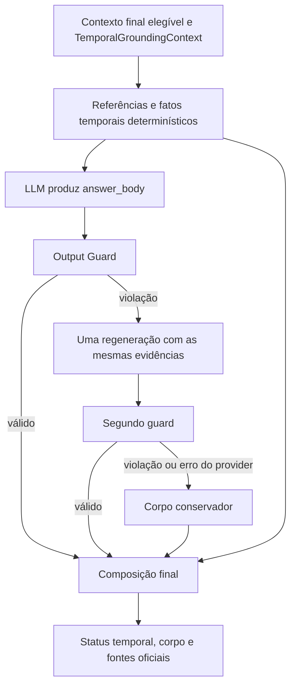

# Structured Normative Output V1 — avaliação controlada

Data: 30/10/2026. Anotações técnicas provisórias, sem validação jurídica humana independente.

A camada estruturada manteve as 213 referências oficiais no teto de artigo e reduziu a exposição de erros nas 44 consultas avaliadas. O resultado veio com custo alto: **23/44 fallbacks**, **21/44 respostas concluídas** pelo protocolo congelado e **duas citações `caput` ainda expostas no corpo final**. Não há evidência de eliminação de alucinações nem de melhora geral da qualidade do modelo. A implementação e o experimento estão concluídos; a avaliação não sustenta prontidão para uso amplo.

## 1. Estado inicial e escopo

- Branch inicial: `fix/temporal-generation-grounding-v1`.
- HEAD inicial verificado: `6aa833d40ec9568aa920947ec7b4cfd74fde6622`.
- Árvore inicial limpa, sem checkpoint vazio.
- Branch de trabalho criada exatamente desse HEAD: `fix/structured-normative-output-v1`.
- Commits locais: `35398e8` (testes RED), `5a4cdb4` (implementação), seguido do commit de evidências desta avaliação.

O trabalho modifica somente geração/apresentação, seus contratos e testes, e acrescenta um runner científico. Não implementa ferramentas, frontend, memória, metadata search ou deploy.

## 2. Problema reproduzido e insuficiência de prompt-only

A etapa anterior melhorou fortemente enquadramento histórico e relações conhecidas, mas apresentou CGVR bibliográfico de 18/44 para 21/44. O serviço construía referências a partir dos chunks, porém retornava o texto livre do provider diretamente como `answer`. Assim, locators e cronologia inventados no corpo eram apresentados ao usuário.

[reproductions.json](reproductions.json) seleciona oito linhas anteriores: subdivisão acima do teto, `art. 62, VI`, quatro afirmações de publicação/eficácia, unknown chamado de vigente e F3 após grounding. A localização está registrada como raw/provider, resultado do serviço e resposta final idênticos; a lista estruturada antiga continuava usando artigo. O conteúdo integral de uma evidência em `Reference.content` é distinto de sua referência bibliográfica.

Nenhuma geração antiga foi refeita ou sobrescrita.

## 3. Arquitetura antes e depois

Antes: contexto final + grounding → LLM → raw como resposta final, com referências de evidência construídas separadamente.

Depois:

Esta camada é ativada quando `RagService.generate` recebe grounding final validado, como no fluxo agentic com filtro temporal habilitado. O caminho de biblioteca sem grounding mantém seu comportamento legado; estes resultados não o validam.

## 4. Referências normativas determinísticas

`NormativeReference` contém `chunk_id`, `norm_id`, `source`, `article`, `validated_subdivision`, `display_text` e `temporal_role`. Não copia o conteúdo inteiro do chunk.

A origem é exclusivamente a correspondência entre chunks finais e `grounding.evidence_states`. Identidade/artigo divergentes ou conjuntos de IDs diferentes são rejeitados. Relações do registry não criam referências de exibição adicionais.

A ordem é `(rank, chunk_id)`. Referências equivalentes por norma/artigo/papel conservam a representante de menor rank/ID. O grounding completo conserva a proveniência dos demais chunks. O teto `source` omite artigo; o teto `article` não autoriza subdivisões.

## 5. Proveniência interna e teto de exibição

O registry e o grounding continuam preservando `956/2025 art. 62, VI`. A referência oficial correspondente é **Resolução 956/2025, art. 62**. `validated_subdivision` permanece `null`, pois o contrato atual valida artigos.

O renderer não interpreta `relation_source.article` como granularidade autorizada para o display. O teste específico confirma que `VI` permanece na proveniência interna e não migra à referência oficial.

## 6. Fatos temporais permitidos

`AllowedTemporalFacts` é derivado do grounding existente, que já projeta audit e registry. Contém somente as classes `HISTORICAL_CONTEXT`, `REVOKED_BY`, `AMENDED_BY`, `STATUS_UNKNOWN`, `CURRENT_CONTEXT` e `COMPARISON_ROLE`.

Não há fatos estruturais de publicação, eficácia, retroatividade, início ou término de vigência. Nenhum é criado. O ano de `956/2025` permanece parte do identificador documental.

## 7. Renderer temporal

O renderer verbaliza os fatos sem hardcode dos quatro números de resolução. Produz enquadramento histórico, impossibilidade de certificar unknown, direção registrada da revogação, alteração parcial e papéis separados em comparação.

`CURRENT_CONTEXT` informa seleção para consulta atual e explicita que isso não certifica vigência. `AMENDED_BY` não transforma alteração parcial em revogação da norma-base. Nenhuma frase determina constitucionalidade, validade da própria revogação, direito adquirido ou retroatividade.

## 8. Corpo gerado e contrato público

O modelo é instruído a explicar conteúdo substantivo em `answer_body`, sem lista de fontes ou decisão autônoma de status temporal. A aplicação acrescenta fontes e status. Não há deduplicador textual genérico nem remoção silenciosa de `art.`, `§` ou incisos.

A API mantém `answer` e `references`. Acrescenta `normative_output`, com referências de display, fatos, status e proveniência temporal estruturada, utilizáveis futuramente sem parsing do texto. As referências legadas continuam carregando trechos para compatibilidade. `output_audit` fica disponível internamente e é excluído da serialização pública padrão.

O prompt-base anterior e os pilotos congelados foram preservados. A nova instrução de corpo é acrescentada ao prompt de geração; é comum aos três escopos. Router prompts não mudaram.

## 9. Guard: cobertura e limites

O componente determinístico não chama LLM, internet, retrieval ou registry. Reporta código, posição e trecho de cada violação, sem modificar o raw.

Cobre formatos delimitados de identificadores, artigos/listas simples, `§`, parágrafo, inciso, alínea e `art. 62, VI`; artigos e normas precisam corresponder às evidências permitidas. Nomes de normas presentes nos fatos de relação podem ser mencionados naturalmente, sem tornarem-se referências oficiais adicionais.

Também cobre formas explícitas de publicação normativa, entrada em vigor, eficácia desde um ano, retroatividade, certificação atual incompatível e relações explícitas invertidas ou de revogação total sem suporte. Reconhece algumas negações de cláusula e distingue publicação acadêmica de publicação normativa. O limite de associação artigo/norma usa uma janela curta e não resolve toda atribuição linguística.

**Não cobre `caput`, paráfrases gerais de eficácia imediata/limites de vigência ou toda forma de negação.** As falhas observadas abaixo mostram esses limites. Não é um parser jurídico geral nem um verificador semântico completo.

## 10. Regeneração

Uma violação permite somente uma regeneração. São conservados prompt-base, pergunta, contexto, grounding, fatos e referências. Apenas a lista estruturada das violações e uma instrução de reescrita são acrescentadas.

O runner verifica igualdade do system prompt e prefixo idêntico do user prompt. Não há nova busca ou informação jurídica nessa tentativa. O limite de duas chamadas é testado.

## 11. Fallback e falha do provider

Se a segunda resposta viola o guard, o corpo passa a informar que não foi possível formular a resposta com segurança a partir das evidências disponíveis. O status temporal e as fontes continuam determinísticos. O fallback não fabrica conteúdo substantivo por template.

Se o provider falha na regeneração, o mesmo fallback conserva o primeiro raw, suas violações e `regeneration_error`. Não há terceira chamada. A falha da primeira chamada continua sob o tratamento já existente do pipeline; não há raw inexistente para preservar.

## 12. Auditoria raw/final

Cada consulta registra `raw_answer`, `guard_violations`, `regenerated_answer`, `second_guard_violations`, `final_answer`, `guard_action` e eventual erro. Raw e regeneração nunca são substituídos pelo corpo conservador nos artefatos científicos.

- [raw_generations.jsonl](raw_generations.jsonl): texto original/regenerado, hashes dos prompts, grounding e receipts sem credenciais.
- [guard_results.jsonl](guard_results.jsonl): decisões e auditoria integral.
- [final_outputs.jsonl](final_outputs.jsonl): resposta pública final e proveniência estruturada.
- [annotations.jsonl](annotations.jsonl): inspeção técnica explícita por consulta, independente da aceitação do guard.

## 13. Desenho experimental

Mesmas oito perguntas/classes e contextos finais congelados da etapa anterior. Repetições: A=10, B=1, C=10, D=1, E=10, F=1, G=1, H/F3=10; total 44.

Modelo `qwen/qwen3-30b-a3b-instruct-2507`, temperatura 0, máximo 800 tokens, top_k 5, endpoint OpenRouter. Embedding model registrado permanece `openai/text-embedding-3-small`, mas **nenhuma chamada de embedding ou retrieval** ocorre neste experimento. O grounding reconstruído foi comparado exatamente ao AFTER salvo. Referências legadas e configuração também foram comparadas.

Foram feitas **68 chamadas de geração**, incluindo 24 regenerações, sem erros de provider. A fase antiga BEFORE/AFTER foi lida dos arquivos. O protocolo foi salvo antes das chamadas reais em [annotation_protocol.json](annotation_protocol.json). Não houve ajuste posterior de prompt, modelo, guard, contexto ou política de retry após observar os resultados novos. Hashes de código estão em [execution.json](execution.json).

## 14. Definições e comparabilidade

CGVR nesta avaliação aplica a política de locators a todo o corpo, incluindo subdivisões mencionadas como objeto da pergunta, artigos/normas não permitidos e `caput`. A CGVR anterior restringia-se à citação bibliográfica explícita. Por isso os números antigos **18/44 e 21/44 não são diretamente comparáveis** à CGVR nova.

[historical_reannotations.jsonl](historical_reannotations.jsonl) reavalia os mesmos raws antigos pelo critério mais amplo, sem modificar seus labels originais. A anotação manual de `caput` é separada do guard: a ausência de violação no guard não equivale a ausência de erro. TCR e cronologia foram inspecionados além das correspondências lexicais.

Todos os denominadores principais são 44 consultas temporais com geração bem-sucedida. As anotações são provisórias, feitas pelo assistente implementador, sem juiz LLM adicional ou gold jurídico independente.

## 15. Métricas raw, referências oficiais e resposta final

| Métrica | Numerador/denominador | Taxa |
|---|---:|---:|
| Raw CGVR | 25/44 | 56,82% |
| Referências oficiais: respostas com violação | 0/44 | 0% |
| Referências oficiais: entradas com violação | 0/213 | 0% |
| Final CGVR, incluindo corpo renderizado | 2/44 | 4,55% |
| Raw Unsupported Chronology Rate | 6/44 | 13,64% |
| Final UCER | 0/44 | 0% |
| Raw TCR | 7/44 | 15,91% |
| Final Temporal Contradiction Exposure Rate | 0/44 | 0% |
| Guard Activation Rate | 24/44 | 54,55% |
| Regeneration Success Rate | 1/24 | 4,17% |
| Fallback Rate | 23/44 | 52,27% |
| Answer Completion Rate | 21/44 | 47,73% |

O único retry aceito é G_unknown, cujo raw já era semanticamente conservador. Portanto, sucesso sintático da regeneração não prova correção de um erro jurídico original. Vinte respostas foram aceitas na primeira tentativa.

## 16. Comparação das três fases

| Critério alinhado | BEFORE_GROUNDING salvo | AFTER_GROUNDING salvo | STRUCTURED raw | STRUCTURED final |
|---|---:|---:|---:|---:|
| CGVR amplo de locators | 20/44 | 23/44 | 25/44 | 2/44 |
| Cronologia não sustentada | 4/44 | 5/44 | 6/44 | 0/44 |
| Contradição temporal | 14/44 | 6/44 | 7/44 | 0/44 |

Os raws novos pioraram numericamente nesses três critérios em relação ao AFTER salvo. A melhora de exposição resulta da composição determinística e dos bloqueios, com perda de conclusão. Não se pode atribuí-la a um modelo que teria parado de produzir erros.

As métricas originais, com suas definições anteriores, permanecem integralmente em [comparison.json](comparison.json), ao lado de 44 comparações por par.

## 17. Resultado por caso

| Caso | n | Raw CGVR | Raw cronologia | Raw TCR | Fallback | Conclusão | Final CGVR |
|---|---:|---:|---:|---:|---:|---:|---:|
| A — graduação histórica | 10 | 10/10 | 1/10 | 1/10 | 10/10 | 0/10 | 0/10 |
| B — graduação atual/amendment | 1 | 1/1 | 0/1 | 1/1 | 1/1 | 0/1 | 0/1 |
| C — pós histórica | 10 | 0/10 | 0/10 | 0/10 | 0/10 | 10/10 | 0/10 |
| D — pós atual | 1 | 1/1 | 0/1 | 0/1 | 1/1 | 0/1 | 0/1 |
| E — validade/revogação | 10 | 10/10 | 5/10 | 5/10 | 10/10 | 0/10 | 0/10 |
| F — comparação | 1 | 1/1 | 0/1 | 0/1 | 1/1 | 0/1 | 0/1 |
| G — unknown | 1 | 0/1 | 0/1 | 0/1 | 0/1 | 1/1 | 0/1 |
| H — F3/citação | 10 | 2/10 | 0/10 | 0/10 | 0/10 | 10/10 | 2/10 |

## 18. F3 e o limite residual `caput`

Nas dez consultas H, nenhuma referência oficial ganhou parágrafo. Duas respostas raw/final acrescentaram `art. 53, caput` sem validação dessa subdivisão; o guard congelado não reconhece esse formato. Portanto F3 não ficou integralmente resolvido no corpo final.

O replay offline do BEFORE H repetição 1, que produzia `§1º`, confirma detecção, duas tentativas e fallback; a subdivisão nunca vira referência oficial. Não houve nova API nesse replay. Os testes unitários também exercitam o caso com uma regeneração limpa e outra reincidente.

## 19. Unknown e CSC

B voltou a chamar a redação de vigente no raw, apesar do status desconhecido; o corpo foi bloqueado, e a apresentação final mantém o aviso e a alteração parcial. G produziu uma resposta epistemicamente correta desde a primeira tentativa, mas uma cláusula negativa não reconhecida acionou o guard. A regeneração foi aceita.

UOR raw: 1/34; final: 0/34. CSC final de apresentação: 12/12, acompanhado de **somente 10/12 corpos concluídos** nos casos current. Segurança de apresentação com fallback não equivale a resposta substantiva completa.

## 20. Cronologia histórica e nova

Os quatro casos AFTER exigidos são E repetições 2/8 (eficácia inventada em 18/12/2025) e 4/10 (publicação inventada em 18/12/2025). Todos são detectados no replay offline e resultam em fallback quando o fake provider repete a falha. Há ainda C repetição 6, com `ambos em vigor na data de sua publicação`, também detectado. Assim, o AFTER salvo tem cinco falhas cronológicas, incluindo a quinta sem data numérica; isso não contradiz a seleção das quatro afirmações datadas.

Nos raws novos, há quatro afirmações de efeito imediato a partir da vigência (E 3/6/7/10) e duas de limite/ordem temporal sem suporte (A9 e E9). São seis, sem publicação explícita datada nem retroatividade. As expressões novas escaparam dos padrões cronológicos, mas **os seis corpos foram bloqueados por locators independentes**. Não atribuímos esses bloqueios à detecção de cronologia.

Os fragmentos `em vigor na graduação` em A5/A10 estão dentro de `Antes da alteração ... estabelecia`; a inspeção adotou leitura passada, sem classificá-los como certificação atual autônoma. A ambiguidade foi preservada nas anotações. F usa `regra vigente ... estabelecia` em comparação passada; não foi rotulado como TCR, embora o guard tenha sinalizado o vocabulário.

## 21. Histórico, validade, alteração e comparação

O renderer mantém framing histórico em 20/20, mas apenas os dez casos C conservam corpo substantivo; os dez A são bloqueados por repetir `§4º` no raw e no retry. Não há nova negação do texto histórico como na falha original, mas a utilidade dessa classe regrediu.

Em E, a direção 658 → 956 aparece deterministicamente, sem inventar data e sem certificar a sucessora como vigente. Os dez corpos são fallback por repetir `art. 62, VI`. A relação registrada já responde parte central da pergunta, mas o protocolo conservador conta fallback como incompleto.

Em B, a apresentação mantém alteração parcial e preserva a norma-base; não há mudança no filtro. Em F, os papéis histórico/posterior e a relação permanecem no status; a comparação substantiva gerada é bloqueada pelo locator 62, VI ausente das referências finais elegíveis.

## 22. Utilidade e resultados negativos

O protocolo congelado exige corpo concluído e exclui todos os fallbacks: 21/44. Esse total inclui uma resposta epistemológica adequada à consulta unknown; se exigirmos conteúdo normativo substantivo além dela, são 20/44. Se contarmos os dez casos E como respondidos pela própria relação determinística, uma leitura alternativa de atendimento à pergunta daria 31/44; ela não substitui o indicador primário congelado.

Os principais negativos são: fallback de 52,27%, baixa eficácia do retry, bloqueio de menções úteis ao dispositivo perguntado, falso positivo em G, cronologia nova não reconhecida e `caput` exposto. Em seis casos, um guard de citação evitou a exposição de cronologia que o guard temporal não reconheceu. Os 0/44 de UCER/TCR final não demonstram cobertura linguística perfeita.

## 23. Limites científicos

Há apenas oito perguntas com repetição concentrada em quatro classes; temperatura zero não garante determinismo nem amostra independente. Contextos finais congelados isolam geração/apresentação, sem medir desempenho de router ou retrieval. A inspeção manual é técnica, do implementador, e pode conter vieses ou ambiguidades.

Não se mediu correção jurídica geral, qualidade total da síntese, constitucionalidade, vigência global ou adequação a casos pessoais. Uma referência no teto de artigo comprova granularidade de apresentação, não que toda afirmação substantiva esteja corretamente vinculada a ela. O guard não substitui essas avaliações.

## 24. Preservação

[preservation_before.json](preservation_before.json) contém hashes de 305 arquivos anteriores e snapshot dos registros. [preservation.json](preservation.json) confirma todos idênticos depois.

- 507 registros; IDs, documentos, metadados e embeddings float32 idênticos.
- SHA-256 do snapshot: `ab253a24b756d9f3d3e05aeb49220798b08d947704112327fd894a577bb2b38a`.
- Corpora, registry/relações, datasets e resultados anteriores preservados byte a byte, inclusive as avaliações temporais, falhas e router.
- Router V1/V2, `agentic.py`/Temporal Intent, VersionFilter e `grounding.py` preservados byte a byte.
- AST de `RagService.retrieve`, `_context` e `_reference` idêntica ao HEAD inicial.
- Nenhuma reindexação, alteração de top_k, embeddings, Chroma, chunking ou estratégia de busca.

## 25. Verificações e entrega local

TDD inicial: 36 falhas esperadas/1 sucesso, depois 37 verdes; novos ciclos RED/GREEN cobriram métricas, erro de provider e achados de revisão. Resultado final:

| Verificação | Resultado |
|---|---:|
| Novos focused | 54 passed |
| Cinco arquivos temporais | 93 passed |
| rag_baseline | 340 passed, 10 skipped |
| Suíte completa | 403 passed, 12 skipped |
| Ruff em oito arquivos | check e format-check aprovados |
| git diff --check | exit 0 |

Os quatro warnings completos são de dependências/infraestrutura legada e estão descritos em [verification.json](verification.json). Uma seleção temporal inicial usou nome de arquivo inexistente, não executou testes e foi corrigida; a contagem informada é da execução correta. Os cinco testes de contrato inicialmente incompatíveis foram atualizados para verificar corpo preservado e composição, mantendo as verificações de escopo e dos prompts-base congelados.

Os unit tests usam providers fake, sem APIs reais. As oito simulações em [offline_replays.jsonl](offline_replays.jsonl) também não fizeram chamadas reais. Os hashes dos artefatos finais estão em `ARTIFACTS.json`, que exclui a si próprio.

Somente commits locais; sem push, merge, rebase, pull, reset ou limpeza destrutiva. Não foram adicionados caches ou credenciais. A entrega para aqui, sem iniciar integrações futuras.
