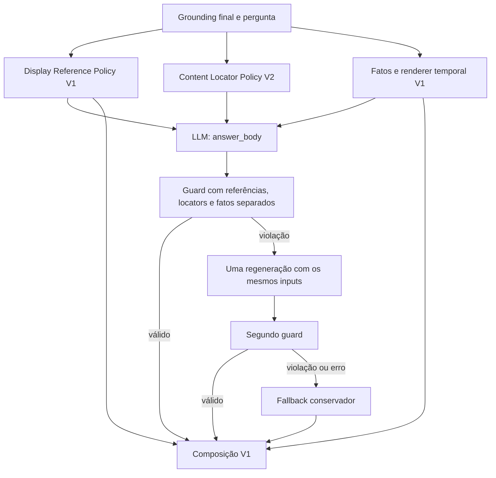

# Structured Normative Output V2 — avaliação controlada

Data: 31/10/2026. Anotação técnica provisória do implementador, sem validação jurídica humana independente.

O V2 recuperou conclusão de **21/44 para 42/44**, reduziu fallback de **23/44 para 2/44** e manteve **0/213 violações nas referências oficiais**. As duas exposições finais de `caput` do V1 não reapareceram nos finais V2. Entretanto, **sete respostas finais acrescentaram datas documentais sem suporte temporal estruturado**. A contagem ampla de exposição cronológica piorou de **0/44 para 7/44**. A separação das políticas recuperou utilidade nos casos controlados, mas a hipótese de conservar integralmente a proteção temporal não foi sustentada nessa leitura ampla. A entrega implementa e avalia V2; não estabelece prontidão para uso amplo.

## 1. Objetivo

Separar referências oficiais de locators legítimos no corpo e detectar diretamente as classes cronológicas residuais observadas no V1. O experimento isola geração/apresentação, sem modificar router, busca, filtro temporal, registry, embeddings ou corpora.

## 2. Baseline V1

Baseline preservado em `structured_normative_output_v1_001`: raw CGVR 25/44; referências oficiais 0/44 respostas e 0/213 entradas com violação; final CGVR amplo 2/44; raw cronologia 6/44; final UCER 0/44; raw TCR original 7/44; final TCR 0/44; ativação 24/44; regeneração aceita 1/24; fallback 23/44; conclusão 21/44. Foram 68 chamadas reais no V1, que não foram repetidas nesta etapa.

Esses valores e labels originais permanecem em [comparison.json](comparison.json). A reanotação alinhada ao V2 está exclusivamente na pasta nova, em [v1_aligned_reannotations.jsonl](v1_aligned_reannotations.jsonl).

## 3. Hipóteses

H_V2 foi sustentada localmente pela recuperação de A e E e pela redução de rejeições de locators suportados. H_CHRONO_V2 foi sustentada apenas no conjunto conhecido: seis detecções diretas em seis raws anteriores. Não houve cobertura cronológica geral: datas documentais novas escaparam.

## 4. Acoplamento reproduzido

O V1 usava a lista de referências oficiais como universo de artigos do corpo e rejeitava toda subdivisão. Assim, A repetia `§4º` legitimamente perguntado e E repetia `62, VI` da proveniência da revogação, causando dez fallbacks em cada classe. `caput` não estava no detector. A negação de G não correspondia aos padrões locais. Os seis raws residuais não acionavam a detecção temporal.

[v1_code_audit.json](v1_code_audit.json) descreve as causas antes da implementação. [v1_reproductions.jsonl](v1_reproductions.jsonl) preserva os 44 raws e findings do guard anterior; [offline_replays_v2.jsonl](offline_replays_v2.jsonl) aplica V2 offline, sem provider.

## 5. Arquitetura V2

`ContentLocatorPolicy` consome contratos estruturados e não depende da origem da recuperação. O caminho sem grounding mantém o comportamento legado. `answer`, `references` e `normative_output` permanecem compatíveis; locators e versão do guard ficam no `output_audit`, excluído da serialização pública padrão.

## 6. Display Reference Policy

`normative_references` permanece com AST idêntica ao HEAD inicial: mesmos IDs finais, validação da identidade norma/artigo, ordem rank/ID, deduplicação por norma/artigo/papel e teto source/article. Nenhuma relação acrescenta referência oficial. `validated_subdivision` continua nulo.

Também permanecem idênticas as ASTs de `allowed_temporal_facts`, `render_temporal_statements` e `compose_answer`.

## 7. Content Locator Policy

`AllowedContentLocator` representa `norm_id`, `article`, tipo/valor de subdivisão, `source` e `authorization_reason`. Permissões de artigo vêm dos estados finais de evidência; subdivisões exigem autorização explícita e vinculada. Um artigo autorizado não implica `caput` ou qualquer parágrafo.

A API do guard recebe `allowed_content_locators` separadamente das referências e fatos. A omissão desse argumento conserva o comportamento conservador dos chamadores diretos anteriores. O serviço fornece explicitamente a política V2.

## 8. Fontes autorizadoras

- `query_explicit`: normalização limitada de artigo, parágrafo, inciso, alínea e caput, vinculada a um par norma/artigo final sem ambiguidade. `§4` isolado na pergunta não autoriza globalmente.
- `amendment_target`: artigo/parágrafo explicitamente registrados no grounding da alteração.
- `normative_relation`: artigo/inciso da prova estruturada de uma relação já selecionada no grounding, com documento-fonte identificado.
- `validated_evidence`: artigo final ou subdivisão explicitamente validada por entrada estrutural própria. Os metadados reais atuais não acrescentam validação de subdivisões; o caso positivo de caput usa fixture estrutural explícita.

Texto bruto de chunk, raw do modelo e proximidade semântica não geram autorização.

## 9. Proveniência interna × display × corpo

Para a revogação registrada: proveniência `956/2025, 62, VI`; referência oficial `Resolução 956/2025, art. 62`; corpo pode mencionar `inciso VI do art. 62` com a permissão da relação. Nos contextos C/F, essa prova pode autorizar menção no corpo mesmo sem se tornar evidência final adicional ou fonte oficial exibida.

Para a alteração: target `177/2012, art. 68, §4`; corpo autorizado; referência oficial continua no artigo. Nenhuma regra usa números de resolução ou IDs de casos para decidir permissões.

## 10. Caput

O parser passa a reconhecer `caput`, `no caput`, `art. X, caput` e `caput do art. X`. Exige suporte escopado. Testes cobrem rejeição, autorização estrutural explícita e manutenção do teto de display. O detector é conservador para a palavra isolada; não pretende resolver todos os usos não normativos.

## 11. F3

`art. 53` permanece permitido. `§1º` e `caput` não autorizados são bloqueados. H1/H6 produziram caput no primeiro raw; ambos foram detectados e regenerados para texto sem essa subdivisão. H concluiu 10/10, com 0/10 exposição final de locator não autorizado. Isso não valida automaticamente outras subdivisões ou a correção substantiva de toda síntese.

## 12. Chronology guard V2

Foram acrescentadas classes para efeito imediato, `a partir da vigência`, entrada em vigor, `passou a vigorar`, produção de efeitos desde um marco, data de publicação e limites relativos à publicação/entrada em vigor. O ano do identificador não vira data de eficácia.

O replay cobre A9 e E3/6/7/9/10 do V1: **6/6 detecções diretas**, sem depender de locators. No raw V2, as seis afirmações de efeitos/entrada em vigor ocorreram em E1/2/3/4/8/9 e todas tiveram finding cronológico. Datas documentais por extenso não são reconhecidas por essa cobertura.

## 13. Unknown e negações

A frase salva de G no V1 passa offline. As formas cobertas de negação conservadora e as afirmações positivas indevidas têm testes separados. Na execução real, G gerou outra forma: `não é possível afirmar, com base nos dados fornecidos, que ... está vigente`. As vírgulas romperam o escopo local e provocaram novo falso positivo.

E4 produziu uma regeneração conservadora com `tampouco autoriza a afirmação ... permanece em vigor`; o segundo guard a rejeitou e gerou fallback. Nenhuma dessas novas formas foi corrigida após a execução.

## 14. TDD

O primeiro arquivo novo foi executado antes da implementação: **49 falhas/6 sucessos**. A ausência do componente de política e a cobertura cronológica/negação insuficiente eram os motivos esperados. O runner teve seu próprio RED: quatro testes falharam por ausência do módulo.

Novos ciclos observaram RED para associação ao ato alterador/framing passado (quatro), lista ambígua de artigos (dois), persistência imediata/hash histórico (dois) e recibo incorreto/perda de raw no erro do retry. As correções foram verificadas antes das chamadas reais. Uma fixture inicialmente supôs `§` nos chunks H; foi corrigida para testar o texto real de A, sem relação nem query autorizadora. Outra referência de fixture foi corrigida de E para A. Esses equívocos e a primeira regressão de fixture estão na trilha de execução.

Resultado final focado: **68 testes V2**, ou **122 incluindo os 54 V1**. A revisão independente foi somente de código/contratos e ocorreu antes do experimento; não constitui juiz jurídico dos resultados.

## 15. Protocolo congelado

[annotation_protocol.json](annotation_protocol.json), [frozen_inputs.json](frozen_inputs.json) e hashes do código foram salvos antes da primeira chamada. HEAD experimental: `ea255c8c28d392f83442c6f85c750f1d410f098d`. O runner ancora os contextos no hash já registrado pelo manifest V1 e verifica os hashes antes de cada tentativa e ao encerrar.

Não houve mudança posterior em prompt, regex, parser, policy, guard, retry, fallback, critérios, perguntas ou contextos. Os artefatos de anotação/relatório foram produzidos após a execução, como avaliação. Não houve execução inválida nem reinício seletivo.

## 16. Mesmos 44 casos e chamadas

A=10, B=1, C=10, D=1, E=10, F=1, G=1, H=10. Mesmas perguntas, chunks finais, referências legadas, grounding e estados temporais do V1. Modelo `qwen/qwen3-30b-a3b-instruct-2507`, temperatura 0, máximo 800 tokens e top_k registrado 5. Não houve chamada de embedding, retrieval, router ou Version Filter no experimento.

Execução entre 00:13:36 e 00:15:44 de 31/10/2026, America/Sao_Paulo. **55 chamadas**, sendo 44 iniciais e 11 regenerações, sem erros de provider. Uso informado: 224.262 tokens e aproximadamente US$ 0,02412; valores conforme recibos, sem inferência de cobrança adicional.

[provider_calls.jsonl](provider_calls.jsonl) registra tentativa, modelo, sucesso, tempo, uso e custo disponível. [provider_attempts.jsonl](provider_attempts.jsonl) preserva imediatamente os 55 textos bem-sucedidos. Os 44 joins raw/guard/final/anotação e os 55 attempts foram reconciliados.

## 17. Resultados raw

| Métrica | Numerador/denominador | Taxa |
|---|---:|---:|
| ULER raw pela política V2 | 3/44 | 6,82% |
| Cronologia raw, contagem ampla | 10/44 | 22,73% |
| Cronologia de publicação/efeitos, leitura restrita | 6/44 | 13,64% |
| Respostas com cronologia corretamente detectada | 6/44 | 13,64% |
| TCR raw pela distinção congelada V2 | 0/44 | 0% |

As dez ocorrências cronológicas amplas são os seis claims de efeito/entrada em vigor e quatro datas documentais por extenso. Elas não foram inferidas somente da decisão do guard: os textos foram inspecionados, incluindo as respostas aceitas.

## 18. Resultados finais e métricas operacionais

| Métrica | Numerador/denominador | Taxa |
|---|---:|---:|
| Official Reference Violation — respostas | 0/44 | 0% |
| Official Reference Violation — entradas | 0/213 | 0% |
| Supported Locator Acceptance Rate | 78/80 | 97,50% |
| Supported Locator False Rejection Rate | 2/80 | 2,50% |
| Final ULER | 0/44 | 0% |
| Known Chronology Detection Recall | 6/6 | 100% |
| Final UCER, contagem ampla | 7/44 | 15,91% |
| Final TCR, leitura primária V2 | 0/44 | 0% |
| Guard Activation | 11/44 | 25,00% |
| Regeneration Success, aceitação do guard | 9/11 | 81,82% |
| Fallback | 2/44 | 4,55% |
| Answer Completion | 42/44 | 95,45% |
| Guard False Positive, primeiro raw | 2/44 | 4,55% |

Aceitação na regeneração não implica ausência de erro: três retries aceitos acrescentaram datas documentais não sustentadas (B1, E1 e E8).

## 19. Referências oficiais

As 213 entradas correspondem exatamente às referências congeladas e continuam no teto de artigo. Taxas por resposta e por entrada são distintas. O campo legado `Reference.content` continua sendo um trecho de evidência, sem representar uma autorização bibliográfica para cada subdivisão nele contida.

## 20. Locators suportados

SLAR/SLFRR contam menções no primeiro raw. Cada ocorrência de artigo e de subdivisão é uma unidade; a forma composta `art. N, VI` conta uma vez por sobrepor os spans. Identificadores documentais isolados e menções no retry não entram nesse denominador. Os spans, bindings revistos e autorizações estão nas anotações.

Foram 80 menções suportadas, 78 sem rejeição de locator. A: 23/23 aceitas; B: 0/2; C: 8/8; D: 10/10 artigos; E: 25/25; F: 1/1; G: 1/1; H: 10/10 artigos. Um corpo pode ter locator aceito e ainda ser rejeitado por cronologia.

## 21. Locators não suportados

Os três raws com violações são D e H1/H6. D repetiu subdivisões não autorizadas no retry e terminou em fallback. H removeu caput no retry. A inspeção não encontrou locator não autorizado nos finais, inclusive no display.

## 22. Cronologia: exposições e sensibilidade

As sete respostas finais com datas documentais são **B1 e E1/5/6/7/8/10**. B1 acrescentou `5 de novembro de 2012`; os seis E acrescentaram `22 de abril de 2024`; E8 também acrescentou `18 de dezembro de 2025` para a resolução sucessora. São oito menções de datas em sete respostas.

O grounding/fatos temporais não fornece essas datas. A anotação ampla as considera cronologia documental não sustentada; **não afirma que sejam factualmente falsas, nem as reclassifica como datas de publicação ou eficácia**. A leitura restrita somente de publicação/efeitos tem raw 6/44 e final 0/44. Ambas as contagens estão expostas, pois a classificação de uma data no título documental é uma limitação relevante da métrica ampla.

No raw novo, a detecção direta cobre 6/10 respostas cronológicas amplas: 60%, com lacuna para as quatro datas documentais. O recall conhecido 6/6 usa apenas as seis instâncias V1 predefinidas e não pode ser interpretado como recall linguístico geral.

## 23. TCR e comparabilidade

O protocolo V2 congelado separa cronologia isolada de contradição de status/relação. A frase parentética do protocolo que chama isso de mesma distinção do V1 é imprecisa: os labels originais V1 incluíam seis claims cronológicos em TCR. O arquivo congelado foi preservado; a inconsistência é declarada aqui.

Por isso **raw TCR V1 original 7/44 e raw TCR V2 0/44 não são diretamente comparáveis**. Na reanotação estrita explícita, V1 tem 1/44 (B). A comparação final permanece 0/44 versus 0/44 na leitura primária.

O retry de B diz `mantendo os demais dispositivos ... em vigor`. A leitura primária considera a cláusula passada de preservação pela alteração parcial, sem certificação atual autônoma, de modo semelhante ao enquadramento passado adotado para A no V1. A expressão é ambígua: uma leitura mais estrita produziria **1/44 TCR final**. Esse resultado alternativo foi preservado; zero primário não é certificado de segurança semântica.

## 24. Falsos positivos

B1 teve dois locators suportados rejeitados porque a forma `conforme alterado pela` ainda vinculou art. 68 ao ato alterador. G1 teve a negação conservadora rompida por vírgulas. São **2/44** no indicador primário de primeiro raw.

E4 teve rejeição falsa no retry, após bloqueio inicial correto de cronologia. É **1/11 retries**, ou uma consulta adicional: **3/44 consultas afetadas por algum falso positivo**, quando incluído esse indicador secundário. O fallback E4 torna visível o custo de utilidade da lacuna de negação.

## 25. Guard Activation

Ativação em B, D, E1/2/3/4/8/9, G e H1/H6: 11/44. Trinta e três corpos foram aceitos na primeira tentativa. A queda frente a 24/44 no V1 não demonstra, isoladamente, maior qualidade de geração.

## 26. Regeneração

Nove de onze retries foram aceitos; duas consultas terminaram em fallback. O runner confirmou system prompt igual e user prompt com prefixo idêntico. Pergunta, evidência, grounding, referências, locators e fatos foram conservados. Não houve terceira chamada.

O sucesso de 9/11 mede aceitação pelo guard. A inspeção encontrou datas não sustentadas em três desses nove retries. A melhora de aceitação não equivale a correção semântica de 9/11 erros.

## 27. Fallback

D e E4 são os dois fallbacks. Em D, o retry ainda mencionava inciso não autorizado. Em E4, uma negação conservadora foi mal interpretada. Ambos conservam o status e as fontes determinísticas e contam como incompletos, inclusive quando o renderer responde parte da pergunta de validade.

## 28. Completion e utilidade

O protocolo primário exclui todos os fallbacks: **42/44**. Esse total inclui G como resposta epistemológica adequada e inclui respostas com exposições cronológicas: conclusão não é correção. Se exigirmos conclusão sem nenhuma das exposições primárias anotadas, restam **35/44**, como indicador secundário, sem substituir a métrica congelada.

## 29. Comparação V1 × V2

| Critério | V1 | V2 |
|---|---:|---:|
| Referências oficiais: respostas com violação | 0/44 | 0/44 |
| Referências oficiais: entradas com violação | 0/213 | 0/213 |
| Final unsupported locator exposure | 2/44 | 0/44 |
| Final cronologia, leitura ampla | 0/44 | 7/44 |
| Final publicação/efeitos, leitura restrita | 0/44 | 0/44 |
| Final TCR, leitura primária | 0/44 | 0/44 |
| Guard Activation | 24/44 | 11/44 |
| Regeneration Success | 1/24 | 9/11 |
| Fallback | 23/44 | 2/44 |
| Answer Completion | 21/44 | 42/44 |
| SLAR, menções reinterpretadas pela política V2 | 42/65 | 78/80 |
| SLFRR, mesma reinterpretação | 23/65 | 2/80 |
| Falso bloqueio de raw permitido pela política V2 | 16/44 | 2/44 |

Os três últimos indicadores V1 são reanotações novas e explícitas: não eram métricas originalmente publicadas pelo V1. O falso positivo G original é mantido separadamente no baseline. Raw CGVR V1 25/44 também não se compara diretamente à ULER raw V2: pela política nova, os mesmos raws V1 têm ULER 3/44, igual à ULER raw observada no V2. Isso impede atribuir ao modelo uma redução de locators indevidos que decorre da mudança de política.

## 30. Resultado por caso

| Caso | n | Raw ULER | Raw cronologia ampla | Ativação | Fallback | Conclusão V1 → V2 | Final ULER | Final cronologia ampla |
|---|---:|---:|---:|---:|---:|---:|---:|---:|
| A — graduação histórica | 10 | 0/10 | 0/10 | 0/10 | 0/10 | 0/10 → 10/10 | 0/10 | 0/10 |
| B — graduação atual/amendment | 1 | 0/1 | 0/1 | 1/1 | 0/1 | 0/1 → 1/1 | 0/1 | 1/1 |
| C — pós histórica | 10 | 0/10 | 0/10 | 0/10 | 0/10 | 10/10 → 10/10 | 0/10 | 0/10 |
| D — pós atual | 1 | 1/1 | 0/1 | 1/1 | 1/1 | 0/1 → 0/1 | 0/1 | 0/1 |
| E — validade/revogação | 10 | 0/10 | 10/10 | 6/10 | 1/10 | 0/10 → 9/10 | 0/10 | 6/10 |
| F — comparação | 1 | 0/1 | 0/1 | 0/1 | 0/1 | 0/1 → 1/1 | 0/1 | 0/1 |
| G — unknown | 1 | 0/1 | 0/1 | 1/1 | 0/1 | 1/1 → 1/1 | 0/1 | 0/1 |
| H — F3 | 10 | 2/10 | 0/10 | 2/10 | 0/10 | 10/10 → 10/10 | 0/10 | 0/10 |

## 31. Decision Trail — decisões aceitas

O registro completo de alternativas, evidência, testes e resultado público é [decision_log.jsonl](decision_log.jsonl), com **13 decisões**. As 12 decisões de comportamento antecedem o experimento; os efeitos observados foram preenchidos depois como resultados. A decisão 013 trata exclusivamente do empacotamento dos bytes no Git, após a avaliação, sem mudar a política ou a execução.

| ID | Problema/evidência | Alternativa rejeitada → decisão | Resultado observado |
|---|---|---|---|
| 001 | A/E: dez fallbacks por classe | teto único → separar display/body | A 10/10, E 9/10; display preservado |
| 002 | § isolado não identifica dispositivo | whitelist global → query escopada | testes positivos/negativos; variante B ainda rejeitada |
| 003 | prova 62, VI fora do display em C/F | promover prova a fonte → permissão apenas de corpo | nenhuma fonte oficial adicional |
| 004 | duas exposições caput V1 | artigo implica caput → suporte explícito | H1/H6 detectados; finais sem caput |
| 005 | seis chronologies escapavam | hardcode de raw → classes linguísticas limitadas | conhecido 6/6; datas documentais escaparam |
| 006 | negação salva G bloqueada | retirar controle de vigência → negação local | replay G passa; nova variante real falha |
| 007 | comparabilidade/custo | mais retries/juiz → um retry e congelamento | 44 consultas, 55 chamadas; sem tuning |
| 008 | proximidade escolhia ato alterador | número mais próximo → vínculo documental limitado | regressões verdes; conforme alterado ainda falha |
| 009 | lista explícita virava artigo omitido | inferência implícita → conservar ambiguidade | duas regressões verdes |
| 010 | nominal passado vigente em F | bloquear palavra sempre → passado com papel histórico | F concluiu; não garante parsing geral |
| 011 | cancelamento podia perder raw/recibo | persistir só ao concluir → gravar cada tentativa | 55 textos duráveis, recibos reconciliados |
| 012 | novo hash não prova baseline histórico | aceitar bytes atuais → ancorar hash V1 | contextos históricos idênticos |
| 013 | Git normalizou finais de linha dos artefatos | substituir hashes → preservar bytes com atributo apenas V2 | arquivos experimentais e blobs reconciliados |

## 32. Decisões rejeitadas

Foram rejeitados remover o guard, autorizar toda subdivisão do chunk/corpo, usar o display ceiling para toda menção, promover a prova interna a referência oficial adicional, aumentar retries, acrescentar segundo LLM como juiz e hardcode por resolução/caso. Cada alternativa rompe a autorização estrutural, mistura os três objetos ou altera a intervenção experimental. Essas rejeições constam de campos explícitos no decision log.

## 33. Resultados negativos preservados

Permanecem: duas rejeições de locator suportado em B; falso positivo de G; falso positivo adicional no retry E4; D incompleto; datas documentais em quatro raws e sete finais; três retries aceitos com datas novas; ambiguidade de vigência em B. Nenhum foi corrigido após a primeira chamada real. O resultado é recuperação de utilidade com lacunas de exposição, não eliminação de alucinações.

## 34. Limitações

Oito perguntas, com repetição concentrada em quatro classes, não formam avaliação jurídica abrangente. Temperatura zero não garante determinismo nem independência estatística. Contextos congelados não medem router ou retrieval. A anotação foi feita pelo implementador, sem juiz LLM ou gold jurídico independente.

A contagem ampla de datas documentais e a leitura temporal de B são explicitamente provisórias e têm análises alternativas. O guard não cobre toda negação, formato de norma, vinculação linguística ou cronologia. Locators autorizados não comprovam que a explicação substantiva esteja correta. Não houve avaliação de direito adquirido, constitucionalidade, vigência global, casos pessoais ou estudo com estudantes.

## 35. Preservação

[preservation_before.json](preservation_before.json) e [preservation.json](preservation.json) confirmam **372 arquivos protegidos idênticos** e **507 registros idênticos**: IDs, documentos, metadados e embeddings float32. Snapshot SHA-256: `ab253a24b756d9f3d3e05aeb49220798b08d947704112327fd894a577bb2b38a`.

Corpora, registry/relações, datasets, todos os resultados anteriores inclusive V1, Router V1/V2, `agentic.py`/Temporal Intent, Version Filter e `grounding.py` foram preservados byte a byte. ASTs de `RagService.retrieve`, `_context` e `_reference` são idênticas. Não houve reindexação ou alteração de busca, top_k, embeddings ou chunking.

## 36. Verificações

| Verificação | Resultado |
|---|---:|
| Focused V2 | 68 passed |
| Structured Output V1/V2 | 122 passed |
| Cinco arquivos temporais | 93 passed |
| rag_baseline | 408 passed, 10 skipped |
| Suíte completa | 471 passed, 12 skipped |
| Ruff, sete arquivos, a partir de code/ | check e format-check aprovados |
| git diff --check | exit 0 |

Os quatro warnings da suíte completa são legados: dois Pydantic de dependência, um AsyncMock no client e um timeout no Starlette TestClient. Testes usam providers fake; somente o estágio real `run` chamou OpenRouter. O código verificado tem os mesmos hashes antes/durante/depois do experimento.

[verification.json](verification.json) contém as contagens e a reconciliação científica. O execution log tem **72 eventos observáveis**, sem credenciais. A auditoria dos decision/execution logs não encontrou raciocínio privado, diário de IA ou segredos. [ARTIFACTS.json](ARTIFACTS.json) contém os hashes dos artefatos, excluindo a si próprio.

## 37. Git e entrega local

Estado inicial auditado: branch `fix/structured-normative-output-v1`, HEAD `98c1c2d605340222a02ad1a7b0b81e77f91ed98a`, árvore limpa. Branch V2 criada exatamente desse HEAD: `fix/structured-normative-output-v2`.

Commits locais: `f250386` — RED; `ea255c8` — implementação; `7736f89` — evidências; seguido pelo commit de preservação de bytes dos artefatos. O SHA desse último commit não consta aqui, pois não pode ser incluído no conteúdo que determina seu próprio hash.

A conferência de blobs detectou conversão CRLF → LF no commit de evidências, apesar dos hashes corretos nos arquivos usados na execução. O PowerShell prosseguiu ao commit após a asserção de conferência falhar. A correção acrescenta somente uma regra `-text` em `.gitattributes` para a pasta V2 e regrava os mesmos bytes experimentais no Git. O experimento não foi invalidado: código, protocolo, contextos, textos e labels permaneceram iguais. Não houve nova chamada. Esse quarto commit é uma correção de preservação, não uma nova versão do V2.

Sem push, merge, rebase, pull, reset ou limpeza destrutiva. Não foram adicionados caches ou credenciais. Não foram implementados frontend, deploy, metadata search, calculator, memória, integração conversacional ou V3. A decisão de congelar o núcleo depende da análise humana destes resultados.
