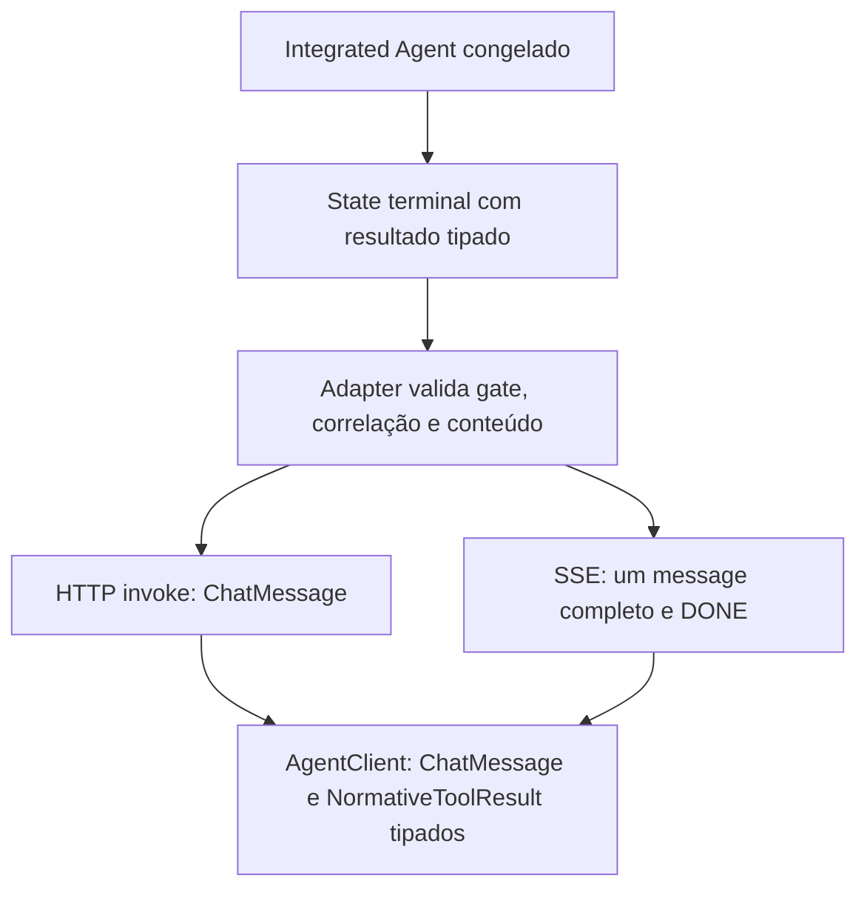

# Typed Normative Transport V1 — service e client intra-turno

Data: 31/10/2026. Verificação local de engenharia, sem LLM real, avaliação jurídica, servidor externo ou reexecução dos 44 casos.

O transporte preservou **16/16 resultados normativos tipados**, **16/16 conteúdos autoritativos**, **9/9 listas de referências oficiais** e **9/9 proveniências temporais** nos casos técnicos avaliados. Houve **0/18 payloads com campos privados**, **0/16 exposições de raw** e concordância **3/3** em pares invoke/stream da mesma execução controlada. O agente integrado continua fora do registry público e não é default.

Esta entrega cobre a fronteira HTTP/SSE/AgentClient do turno corrente por injeção do grafo no harness. Não entrega memória, frontend ou exposição pública do agente. Duas tentativas dos probes falharam por infraestrutura; estão preservadas e não entram nas métricas. A conclusão não estabelece prontidão para produção ou confiabilidade jurídica.

## 1. Objetivo

Transportar o resultado autoritativo do IntegratedAgentState para ChatMessage e AgentClient, sem reescrita ou reconstrução textual. O núcleo, facade, tool, policy, grafo e emission gate selecionados continuam congelados.

## 2. Estado inicial

Branch `feat/agent-normative-integration-v1`, HEAD `459dab7c9bcf4a9470f2855d31ceabbe008c8998`, árvore limpa. [initial_audit.json](initial_audit.json) registra status, branch, HEAD, log de 15 commits, diffs e stat. A branch `feat/typed-normative-transport-v1` foi criada exatamente desse HEAD.

## 3. Arquitetura anterior

O grafo interno já terminava em emissão autoritativa e conservava NormativeToolResult no state. O serviço legado convertia a última AIMessage em ChatMessage, enquanto o stream projetava updates/custom/messages e tokens. O client validava ChatMessage, que não tinha campo normativo.

## 4. Problema de transporte localizado

`invoke` usava somente `response["messages"][-1]`; `langchain_to_chat_message` não consumia state nem artifact e descarta ToolMessage.artifact. `message_generator` convertia updates e tokens sem transportar normative_result. `AgentClient` reconstruía ChatMessage por `model_validate`, mas o campo ausente era ignorado pelo schema anterior. O converter legado permaneceu intacto; o novo adapter lê o state completo.

## 5. Contrato de mensagem

[schema.py](../../../code/src/schema/schema.py) acrescenta `normative_result: NormativeToolResult | None = None`. Sem novo response_kind ou versão global: a presença do campo já distingue a mensagem normativa, e status continua pertencendo ao resultado. Mensagens antigas sem campo continuam válidas.

O contrato valida que resultado normativo aparece somente em mensagem AI e que content coincide exatamente com o campo autoritativo do status. Objetos internos são convertidos por dump público antes da validação; dict recebido com internal_audit é recusado. Não se usa custom_data, JSON dentro de content ou dict arbitrário como resultado final.

## 6. Import boundary

Reuso direto de NormativeToolResult, sem duplicação ou deslocamento de contratos. `schema` importa seu módulo em rag_baseline; não há import inverso de schema, service ou agents em rag_baseline. O package initializer normativo não constrói providers. [contract_checks.json](contract_checks.json) registra a fronteira, o schema de serialização pública e verificações de AST.

A importação de `service` ainda atravessa o registry legado e constrói um modelo de supervisor no import. Isso é limitação anterior, não introduzida pelo campo novo, e fundamenta a decisão de injeção em vez de registro público nesta fase.

## 7. Payload normativo público

NormativeToolResult conserva contract_version `1` e core_version `structured_output_v2`. Inclui answer, referências oficiais, provenance, fatos/status temporal, domain, retrieval_strategy, core_status, correlação e campos de clarification/error permitidos pelo contrato.

O adapter usa somente `model_dump()` público e valida novamente o modelo. Não usa to_persistence(), conteúdo de ToolMessage, referências legadas com trechos ou audit privado. O schema de serialização pública não contém internal_audit. Os modelos recebidos pelo client têm audit privado nulo.

## 8. Invoke

`POST /{agent_id}/invoke` mantém a rota existente. Para um CompiledStateGraph confiável com o nome do builder integrado, o serviço lê o state retornado por ainvoke e chama [project_integrated_state](../../../code/src/service/normative_transport.py). Verifica AIMessage final, ação, conclusão do gate, fonte de emissão e correlação; a validação de ChatMessage garante conteúdo idêntico. Acrescenta somente run_id ao envelope.

Não consulta aget_state nesse caminho, pois o grafo integrado não tem checkpointer nem resume nesta V1. thread_id/user_id/run_id continuam distintos de correlation_id. A branch legada de invoke permanece com sua projeção anterior.

## 9. Stream

O caminho integrado usa `astream(stream_mode="values")` no grafo superior e mantém final_state local à requisição. Nenhum valor intermediário é publicado. Depois de terminar a iteração e validar o state terminal, emite uma ChatMessage completa e DONE.

## 10. Token safety e SSE

Foi conservado o envelope SSE existente: `type=message`, content como ChatMessage serializado, seguido de `[DONE]`. Nenhum novo tipo de evento foi necessário. Para o grafo integrado, stream_tokens não libera tokens, drafts, raws, regenerações, custom events ou ToolMessages. DIRECT determinístico também emite mensagem completa.

O stream legado continua usando updates/messages/custom e tokens string. Um teste bloqueia a facade com asyncio.Event e confirma que o gerador não emite antes de sua conclusão e do gate. Estados com emissão incompleta, correlação divergente ou conteúdo alterado produzem erro genérico, sem mensagem normativa publicada.

## 11. Client invoke

[client.py](../../../code/src/client/client.py) conserva as assinaturas invoke/ainvoke e passa a centralizar a validação em `_parse_message`. Ambos retornam ChatMessage cujo normative_result é NormativeToolResult, com enums, UUID e modelos aninhados reais. Payload inválido gera AgentClientError explícito, sem incluir os dados recusados na mensagem de erro.

## 12. Client stream

stream/astream usam o parser de message existente, agora com o campo tipado. Tokens legados continuam str. Não existe helper de reescrita, resumo, formatação ou extração de referências. Os testes cobrem as quatro operações sync/async do client através do harness HTTP/SSE.

## 13. References

As listas oficiais são comparadas estruturalmente por modelo, referência por referência, antes/depois do transporte: chunk_id, norm_id, source, article, validated_subdivision, display_text e temporal_role. A métrica 9/9 usa respostas ANSWER com lista integral igual, não apenas quantidade de entradas. Reference.content legado nunca é promovido.

## 14. Temporal provenance

temporal_provenance conserva o modelo completo, incluindo estados de evidência, relações, contexto solicitado e constraints públicos. A comparação 9/9 é igualdade estruturada em ANSWER, sem repr ou reconstrução do texto. allowed_temporal_facts e temporal_status_text também sobrevivem no dump público completo.

## 15. Correlation, domínio e estratégia

correlation_id é o UUID produzido pelo grafo e não é recriado pelo service/client. Preservação 16/16. domain, retrieval_strategy, core_status e versões são comparados no resultado inteiro; enums e nulidade dos campos conforme status são preservados. run_id é envelope de execução do serviço e não substitui a correlação normativa.

## 16. Clarification e DIRECT

CLARIFICATION chega com pergunta exata e mesma correlação, sem answer, referências ou provenance fabricadas. O cenário usa Router V1 real com provider controlado, sem embedding ou geração. Não cria pending clarification ou continuação entre turnos.

DIRECT “Oi” chega como “Olá!” e normative_result null, sem facade call. Não há resultado normativo vazio para representar conversa social.

## 17. Errors

ERROR estruturado do núcleo é transportado como mensagem HTTP 200/contrato normal com safe_message exata, error_code e correlação. Exceções do adapter continuam sob a política genérica existente: HTTP 500 em invoke ou SSE error/DONE, sem resultado normativo falso. Não publica traceback, exception string, caminho, provider body ou audit.

## 18. Regeneração e fallback

Os testes exercitam uma primeira geração inválida seguida de regeneração limpa, e duas gerações inválidas seguidas de fallback V2. O client recebe somente answer final, referências autorizadas e core_status correto. Fallback permanece status ANSWER com core_status fallback; não vira transport error.

O probe stream_fallback exercita o núcleo real com duas gerações fake inválidas. O raw sentinel não aparece no SSE. Aceitação e transporte não corrigem as limitações científicas conhecidas do V2, inclusive as datas documentais do experimento anterior, não repetido aqui.

## 19. Campos privados

Os testes inspecionam keys recursivamente, distinguindo campos de palavras legítimas dentro do texto. São recusados/ausentes internal_audit, output_audit, raw_answer, regenerated_answer, guard_violations, prompt, embedding, provider_response, api_key, token e secret no payload normativo público. Sentinels de raw são verificados separadamente.

Nos probes, **0/18 payloads públicos** tiveram essas keys e **0/16 transportes normativos** expuseram sentinels raw. Não se afirma que essa verificação finita detecta todo segredo possível. Os recibos e prompts não fazem parte dos artefatos públicos do harness.

## 20. Agent registration

Escolhida opção A: grafo injetado somente no harness, com os paths reais `/chatbot_ufpi_integrated_v1/invoke` e `/stream`. O registry é eager e o lifespan conecta saver/store em todos os registrados; registro B exigiria ampliar o escopo para não introduzir memória/inicialização indevida. Nenhum agente legado foi removido ou alterado.

O adapter reconhece CompiledStateGraph e o nome estável do builder, vindos de configuração de aplicação confiável; flags em agent_config não escolhem a política de transporte. Esta fase não registra o ID no serviço instalado nem anuncia suporte novo em /info. Exposição pública e factory de runtime continuam pendentes.

## 21. Default preservation

DEFAULT_AGENT continua `chatbot_ufpi_v2`. O teste explícito confirma default e ausência do ID integrado no registry. O arquivo do registry permanece byte a byte igual. Drift = **0/1** verificação.

## 22. Backward compatibility

Cinco fixtures técnicas explícitas — human, ai, tool, custom sem campo normativo e token legado — permaneceram válidas: **5/5**. A regressão do serviço/client/app permanece separada dessa taxa; não se usa a contagem da suíte como denominador artificial de mensagens.

O campo novo é aditivo e nulo para mensagens legadas. custom_data mantém sua semântica anterior. Não houve mudança de UI, user/thread ownership ou feedback. As funções legadas fora da intervenção, incluindo history, feedback, info, health e lifespan, têm AST idêntica ao HEAD inicial.

## 23. Concorrência

Invoke metadata_exact/graduação e stream vector_filtered/pós ocorreram simultaneamente no mesmo grafo/facade, conservando resultados, referências, domínio e correlação distintos. O state de stream é uma variável local, sem cache global de último resultado. Não se mediu carga ou isolamento persistente por usuário.

## 24. Protocolo e probes

[technical_protocol_initial.json](technical_protocol_initial.json) foi salvo antes da primeira tentativa, com inputs, critérios e hashes. A primeira tentativa parou no import do supervisor por falta da chave fictícia que pytest_env fornece. Zero casos foram executados nessa tentativa.

A segunda executou o harness, mas falhou na limpeza do Chroma temporário pelo Windows antes de gravar o resultado final. Suas métricas não foram usadas. [probe_attempts.jsonl](probe_attempts.jsonl) conserva ambas as ocorrências; o harness original permanece em [local_probes_initial.py](local_probes_initial.py).

A revisão 2 do protocolo, em [technical_protocol.json](technical_protocol.json), alterou somente o hash do harness: tolerância à falha de limpeza temporária e gravação imediata de cada linha em [probe_rows.jsonl](probe_rows.jsonl). [protocol_amendment.json](protocol_amendment.json) confirma inputs/critérios idênticos e zero mudanças produtivas após o congelamento. A repetição foi integral, sem seleção de casos. Não se afirma que houve uma única execução sem falhas de infraestrutura.

[local_probes.json](local_probes.json) registra 11 grupos primários/12 execuções, mais três pares da mesma execução controlada com seis transportes: **18 payloads**. Os pares usam replay do mesmo state já concluído, para comparar UUID exato sem tratar duas novas consultas como uma operação. O replay é exclusivo do harness, sem cache ou memória produtiva. Casos primários usam grafo, Router, selector, Chroma e V2 reais com provider fake; Chroma temporário contém dez chunks e vetores controlados 2D, sem alegação de relevância. HTTP externo foi bloqueado; não houve servidor externo ou API real.

## 25. Métricas técnicas

| Métrica | Numerador/denominador | Unidade |
|---|---:|---|
| Typed Transport Preservation | 16/16 | mensagens normativas no client |
| Authoritative Content Preservation | 16/16 | igualdade exata por status |
| Official Reference Preservation | 9/9 | listas completas das respostas ANSWER |
| Temporal Provenance Preservation | 9/9 | modelos completos das respostas ANSWER |
| Correlation Preservation | 16/16 | UUID normativo |
| Private Field Leakage Count | 0/18 | payloads públicos |
| Normative Raw Exposure Count | 0/16 | transportes normativos |
| Legacy Compatibility | 5/5 | quatro mensagens e um token definidos |
| Invoke/Stream Semantic Agreement | 3/3 | pares de state concluído: ANSWER, CLARIFICATION, ERROR |
| Default Agent Drift | 0/1 | default inalterado |

Nove mensagens são ANSWER; as demais normativas são clarification/error. Nos campos não aplicáveis, a nulidade contratual também foi comparada. Os payloads primários e de agreement compõem os denominadores; as tentativas de infraestrutura sem artefato final são descritas separadamente. Essas métricas não são jurídicas.

## 26. Resultados negativos

Permanecem: registro público/factory não implementados, import legado dependente de configuração, ausência de history tipado, ownership, memória e rendering. Houve duas falhas de infraestrutura dos probes e uma revisão documentada do harness após o congelamento inicial. Nenhum resultado de transporte foi retunado ou selecionado para obter taxas finais.

TDD inicial: 41 falhas esperadas/1 sucesso; primeiro GREEN 42. Nove verificações adicionais cobrem correlação de clarification real, agreement, ordenação de emissão e rejeição de estados terminais inválidos; focused final 51. Warnings adicionais do primeiro harness vinham de passar timeout a TestClient; o harness deixou de passar esse argumento antes do congelamento. Não houve correção do código normativo.

## 27. Limitações e próxima etapa

Avaliação local com providers e geração controlados, sem qualidade jurídica, usuários, disponibilidade, carga, cobrança ou produção. O agente integrado não está invocável pelo registry instalado; a evidência é dos endpoints reais com injeção confiável no harness. As taxas não autorizam declarar segurança geral ou prontidão.

/history permanece sem reconstrução tipada persistida. A próxima fase poderá ser **Conversation Memory & Grounded Follow-ups V1**, com ownership e persistência privada explícita por thread/agente/correlação/versão, após revisão. Ela não foi iniciada. Streamlit, calculator e Docker/deploy continuam intocados.

## 28. Decisões públicas

[decision_log.jsonl](decision_log.jsonl) registra modelagem, import boundary, reuso do contrato, projeção, SSE, token suppression, client, registro, compatibilidade e revisão do harness. [execution_log.jsonl](execution_log.jsonl) registra auditoria, RED/GREEN, revisão de código, tentativas dos probes, congelamento, verificações e commits. Não são transcrições ou registros de raciocínio privado.

## 29. Preservação

[preservation_before.json](preservation_before.json) e [preservation.json](preservation.json) conferem **654 arquivos iniciais: 651 idênticos e três alterações autorizadas**, em schema/schema.py, service/service.py e client/client.py. Novo módulo produtivo: service/normative_transport.py. Não se declara que os três arquivos autorizados ficaram intactos.

Router V1/V2, Temporal Intent, dense, estratégias, Version Filter, grounding, Structured Output, NormativeToolResult, facade, tool, action policy, agent graph, emission gate, registry/default, corpora e todos os resultados anteriores permanecem byte a byte iguais. Os **507 registros** preservam IDs, documentos, metadados e embeddings float32. SHA-256 lógico: `ab253a24b756d9f3d3e05aeb49220798b08d947704112327fd894a577bb2b38a`. Sem reindexação ou re-embedding.

## 30. Verificações

[test_results.json](test_results.json) registra comandos, timestamps, contagens e stdout das seleções finais; seleções sobrepostas não devem ser somadas. Ruff check e format-check cobrem sete Python, incluindo as duas versões do harness. git diff --check é conferido antes dos commits.

| Seleção | Resultado |
|---|---:|
| Novos focused transport | 51 passed |
| Agent Integration | 61 passed |
| Retrieval Strategies | 76 passed |
| Facade/contracts | 79 passed |
| Structured Output V1/V2 | 122 passed |
| Cinco arquivos temporais | 93 passed |
| rag_baseline | 675 passed, 10 skipped |
| Service legado | 24 passed |
| Client legado | 9 passed |
| App/integration legados | 7 passed, 2 skipped |
| Core legado | 23 passed |
| Suíte completa | 738 passed, 12 skipped |
| Ruff check/format-check | aprovados |
| git diff --check | exit 0 |

Os quatro warnings completos são legados: dois Pydantic de dependência, AsyncMock no client e timeout de Starlette TestClient. Os focused transport têm somente os dois warnings de dependência. Docker opt-in permaneceu skipped; AppTest é harness isolado, sem frontend ao vivo. A revisão de código não encontrou Critical/Important; não é validação jurídica.

## 31. Commits e entrega local

1. `8bfedc7` — `test: define typed normative transport boundaries`.
2. Implementação — `feat: transport normative results through service and client`.
3. Evidências — `test: verify typed normative invoke and stream contracts`.

O commit de evidências não pode incluir seu próprio hash. Manifest, verification e ARTIFACTS registram hashes e escopo; ARTIFACTS exclui a si próprio. Atributos -text aplicam-se somente à nova pasta de resultados.

Sem push, merge, rebase, pull, reset ou limpeza destrutiva. Agente novo não-default e não registrado. Sem memória multi-turn, follow-up grounded, pending clarification persistida, Streamlit, calculator, deploy ou API externa. Não foram adicionados artefatos de processo de IA. A entrega termina no transporte tipado do turno corrente.
